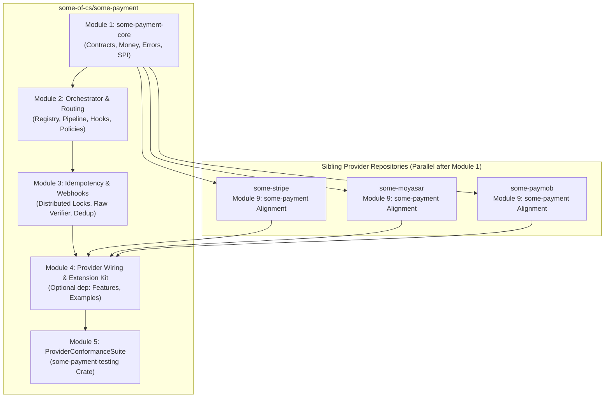

# Master Architecture Decomposition Roadmap — `some-payment` Ecosystem

- **Source Specification**: [`docs/sdk-implementation.md`](../sdk-implementation.md)
- **Field Profile**: `software` (Rust Edition 2024, MSRV `1.85+`, Apache-2.0)
- **Topology Strategy**: Option A — Dependency Inversion via HTTP-free `some-payment-core` contract crate at the base of the dependency graph
- **Total Scope**: 4 coordinated repositories (`some-payment`, `some-stripe`, `some-moyasar`, `some-paymob`) — **8 Modules**, **16 User Stories**, **67 Parallel Implementation Units**

---

## 1. Cross-Repository & Cross-Module Dependency DAG

---

## 2. Repository & Module Summary Matrix

### 2.1 `some-of-cs/some-payment` (5 Modules · 10 User Stories · 40 Parallel Units)

| Merge Order | Module ID | Branch | User Stories | Units ($K$) | Primary Crate / Path | Spec Directory |
| :---: | :--- | :--- | :---: | :---: | :--- | :--- |
| **1st** | `module-1-core-contracts` | `feat/module-1-core-contracts` | 2 (`US-1.1.0`, `US-1.2.0`) | 9 (4 + 5) | `crates/some-payment-core/` | [`module-1-core-contracts`](../user-stories/module-1-core-contracts/README.md) |
| **2nd** | `module-2-orchestrator-routing` | `feat/module-2-orchestrator-routing` | 2 (`US-2.1.0`, `US-2.2.0`) | 8 (4 + 4) | `src/{registry,hooks,orchestrator,routing}/` | [`module-2-orchestrator-routing`](../user-stories/module-2-orchestrator-routing/README.md) |
| **3rd** | `module-3-idempotency-webhooks` | `feat/module-3-idempotency-webhooks` | 2 (`US-3.1.0`, `US-3.2.0`) | 8 (4 + 4) | `src/{idempotency,webhooks}/` | [`module-3-idempotency-webhooks`](../user-stories/module-3-idempotency-webhooks/README.md) |
| **4th** | `module-4-provider-wiring` | `feat/module-4-provider-wiring` | 2 (`US-4.1.0`, `US-4.2.0`) | 7 (4 + 3) | `src/providers/`, `examples/` | [`module-4-provider-wiring`](../user-stories/module-4-provider-wiring/README.md) |
| **5th** | `module-5-conformance-testing` | `feat/module-5-conformance-testing` | 2 (`US-5.1.0`, `US-5.2.0`) | 8 (4 + 4) | `crates/some-payment-testing/` | [`module-5-conformance-testing`](../user-stories/module-5-conformance-testing/README.md) |

### 2.2 Sibling Provider Alignment Modules (3 Repos · 3 Modules · 6 User Stories · 27 Parallel Units)

| Repository | Module ID | Branch | Upstream Prerequisite | Stories | Units ($K$) | Spec Link |
| :--- | :--- | :--- | :--- | :---: | :---: | :--- |
| `some-of-cs/some-stripe` | `module-9-some-payment-alignment` | `feat/module-9-some-payment-alignment` | `some-payment` Module 1 | 2 (`US-9.1.0`, `US-9.2.0`) | 9 (5 + 4) | `docs/user-stories/module-9-some-payment-alignment/README.md` |
| `some-of-cs/some-moyasar` | `module-9-some-payment-alignment` | `feat/module-9-some-payment-alignment` | `some-payment` Module 1 | 2 (`US-9.1.0`, `US-9.2.0`) | 9 (5 + 4) | `docs/user-stories/module-9-some-payment-alignment/README.md` |
| `some-of-cs/some-paymob` | `module-9-some-payment-alignment` | `feat/module-9-some-payment-alignment` | `some-payment` Module 1 | 2 (`US-9.1.0`, `US-9.2.0`) | 9 (5 + 4) | `docs/user-stories/module-9-some-payment-alignment/README.md` |

---

## 3. Strict Cross-Module Merge Order to `main`

1. **Wave A — Foundation**: Merge `some-payment` **Module 1 (`module-1-core-contracts`)** to `main` and publish/tag `some-payment-core v0.1.0`.
2. **Wave B — Parallel Core & Provider Alignment**:
   - In `some-payment`: Merge **Module 2 (`module-2-orchestrator-routing`)**, then **Module 3 (`module-3-idempotency-webhooks`)** sequentially into `main`.
   - In parallel across sibling repositories: Execute and merge **`some-stripe` Module 9**, **`some-moyasar` Module 9**, and **`some-paymob` Module 9** into their respective `main` branches (all 3 are completely independent once `some-payment-core` is available).
3. **Wave C — Optional Feature-Gated Provider Wiring**: After `some-payment` Module 3 and all three sibling Module 9 PRs merge, merge `some-payment` **Module 4 (`module-4-provider-wiring`)** into `main` with isolated CI feature matrix checks (`cargo check --no-default-features --features stripe`, `moyasar`, `paymob`, `all-providers`).
4. **Wave D — Conformance Suite Verification**: Merge `some-payment` **Module 5 (`module-5-conformance-testing`)** into `main` and run `ProviderConformanceSuite` against all three first-party providers plus a custom third-party mock provider.
