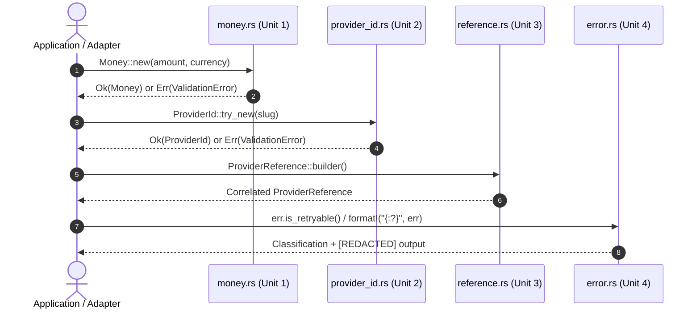

# User Story `US-1.1.0`: Canonical Domain Primitives, Minor-Unit `Money`, `ProviderId`, `ProviderReference` & Typed `PaymentError`

- **Module**: `module-1-core-contracts` (Core Contracts (`some-payment-core`))
- **Story Branch**: `feat/us-1.1.0-domain-primitives-and-errors`
- **Field Profile**: `software`
- **Story Decomposition Score ($S_{\text{story}}$)**: `2.40` $\to$ **`4` Parallel Implementation Units (`unit-1..4`)**

---

## 1. Spec Kit Specifications

### 1.1 User Story Narrative
> **As a** payment platform engineer building `some-payment` and provider adapters,  
> **I want** a zero-HTTP, strongly typed set of domain primitives (`Money`, `ProviderId`, `ProviderReference`, `PaymentError`) in `some-payment-core`,  
> **So that** all gateways share exact integer minor-unit math, open string provider IDs, cross-lifecycle correlation, and secret-redacted errors without cyclic dependencies.

Implements the base domain types required by Option A dependency inversion. Eliminates floating-point money bugs, closed provider enums, and accidental secret leakage in logs.

#### 1.1.1 Preconditions
- Root workspace `Cargo.toml` and `crates/some-payment-core/Cargo.toml` are scaffolded on `feat/module-1-core-contracts`.
- Zero HTTP transport crates (`reqwest`, `hyper`) are added to `some-payment-core`.

#### 1.1.2 Postconditions
- `Money` enforces `amount > 0` integer minor units and uppercase 3-letter ISO-4217 currency codes.
- `ProviderId` normalizes slugs to lowercase ASCII (`[a-z0-9_-]{1,64}`).
- `ProviderReference` correlates `payment_id`, `transaction_id`, `order_id`, `intent_id`, and `checkout_session_id`.
- `PaymentError` classifies retryability and redacts secrets in `Debug`/`Display`.

### 1.2 Acceptance Criteria (Gherkin Scenarios)
```gherkin
Feature: Core Payment Domain Primitives & Typed Error Hierarchy

  Scenario: AC-1 — Construct valid integer minor-unit Money
    Given an amount of 15000 minor units and currency "sar"
    When Money::new(15_000, "sar") is called
    Then it succeeds with amount == 15_000 and currency == "SAR"

  Scenario: AC-2 — Reject zero amount or invalid ISO-4217 currency
    Given an amount of 0 or a currency code "US" or "123"
    When Money::new is called
    Then it returns Err(PaymentError::ValidationError) without panicking

  Scenario: AC-3 — Normalize open ProviderId without closed enum
    Given a third-party provider slug "  Tap-Payments  "
    When ProviderId::try_new("  Tap-Payments  ") is called
    Then it succeeds with as_str() == "tap-payments"

  Scenario: AC-4 — Redact secrets in PaymentError Debug and Display output
    Given a PaymentError containing redacted vendor metadata and retry_after
    When formatted with {:?} or {}
    Then no secret key prefix (sk_, whsec_, egypt_sk_) or raw card PAN appears in output
```

### 1.3 Test Cases & Traceability Matrix

| Test Case ID | Mapped AC | Owning Unit | Test Level | Description & Input Vector | Expected Result & Pass Threshold |
| :--- | :---: | :---: | :---: | :--- | :--- |
| `TC-1.1.1` | `AC-1` | `unit-1` | Unit | `Money::new(15_000, "sar")`, `JPY` (0-dec), `KWD` (3-dec) | Uppercase currency, exact minor-unit integer preserved |
| `TC-1.1.2` | `AC-2` | `unit-1` | Boundary | `Money::new(0, "USD")`, invalid currency, `checked_add` overflow | `Err(ValidationError)` / `None` on overflow |
| `TC-1.1.3` | `AC-3` | `unit-2` | Unit | `ProviderId::try_new("  Stripe ")`, empty, path-traversal `"../x"` | Normalized `"stripe"`; invalid inputs rejected |
| `TC-1.1.4` | `AC-1` | `unit-3` | Unit | `ProviderReference` serde round-trip with `transaction_id` & `order_id` | All correlation IDs preserved losslessly |
| `TC-1.1.5` | `AC-4` | `unit-4` | Security | Format `CardDeclined`, `ThreeDsFailed`, `AuthenticationError`, `RateLimited` | Accurate `is_retryable()` and `[REDACTED]` secret hygiene |

---

## 2. Technical Implementation Plan

### 2.1 Domain Invariants & Storage Schema
- **Integer Minor Units Only**: `Money { amount: u64, currency: CurrencyCode }` with `amount > 0` and zero `f32`/`f64`.
- **Open `ProviderId`**: Trimmed lowercase ASCII matching `^[a-z0-9][a-z0-9_-]{0,63}$`.
- **Structured `PaymentError`**: Separates `CardDeclined`/`ThreeDsFailed` from `AuthenticationError`/`ConfigurationError`/`Unsupported` and transient `RateLimited`/`ProviderUnavailable`.

### 2.2 Sequence Diagram


---

## 3. Expected Folder Architecture at the Project

```text
crates/some-payment-core/
├── Cargo.toml                  # Seeded on Module 1 base branch
└── src/
    ├── lib.rs                  # Seeded on Module 1 base branch
    ├── money.rs                # Owned exclusively by unit-1
    ├── provider_id.rs          # Owned exclusively by unit-2
    ├── reference.rs            # Owned exclusively by unit-3
    └── error.rs                # Owned exclusively by unit-4
```

---

## 4. Implementation Units in Detail & Specialist Agent Assignment

### 4.1 Story Decomposition Score ($S_{\text{story}}$) & Dynamic Unit Count ($K$)
- **$D_1$ (35% Surface)**: `2` — 4 core value types (`Money`, `ProviderId`, `ProviderReference`, `PaymentError`)
- **$D_2$ (25% Volume)**: `2` — ~550–650 production LOC + unit tests
- **$D_3$ (20% Complexity)**: `3` — 0/2/3-decimal currency validation, checked integer math, secret-redacted `Debug`
- **$D_4$ (20% Boundaries)**: `3` — 4 completely disjoint Rust modules under `crates/some-payment-core/src/`
- **Calculated Score**: $S_{\text{story}} = 0.35(2) + 0.25(2) + 0.20(3) + 0.20(3) = \mathbf{2.40}$ $\to$ **`4` Parallel Units**

### 4.2 Detailed Unit Specifications (`unit-1..4`)
- **`unit-1` (`feat/us-1.1.0/unit-1-money`)**:
  - **Deliverable Scope**: Integer minor-unit `Money`, `CurrencyCode`, 0/2/3-decimal table, checked arithmetic
  - **Owned Files**: `crates/some-payment-core/src/money.rs`
  - **Public Contract / Exports**: `Money`, `CurrencyCode`, `MinorUnitScale`
  - **Unit Verification & Target Complexity**: Unit tests + doc-tests for `crates/some-payment-core/src/money.rs`, Max Cyclomatic Complexity $CC \le 6$ (cap $\le 10$, nesting $\le 2$)
- **`unit-2` (`feat/us-1.1.0/unit-2-provider-id`)**:
  - **Deliverable Scope**: Normalized lowercase open `ProviderId` newtype with validation & serde
  - **Owned Files**: `crates/some-payment-core/src/provider_id.rs`
  - **Public Contract / Exports**: `ProviderId`
  - **Unit Verification & Target Complexity**: Unit tests + doc-tests for `crates/some-payment-core/src/provider_id.rs`, Max Cyclomatic Complexity $CC \le 6$ (cap $\le 10$, nesting $\le 2$)
- **`unit-3` (`feat/us-1.1.0/unit-3-reference`)**:
  - **Deliverable Scope**: `ProviderReference` correlating `payment_id`, `transaction_id`, `order_id`, `intent_id`, `checkout_session_id`
  - **Owned Files**: `crates/some-payment-core/src/reference.rs`
  - **Public Contract / Exports**: `ProviderReference`, `ProviderReferenceBuilder`
  - **Unit Verification & Target Complexity**: Unit tests + doc-tests for `crates/some-payment-core/src/reference.rs`, Max Cyclomatic Complexity $CC \le 6$ (cap $\le 10$, nesting $\le 2$)
- **`unit-4` (`feat/us-1.1.0/unit-4-error`)**:
  - **Deliverable Scope**: Redacted `PaymentError` taxonomy (`thiserror`), `is_retryable()`, `http_status()`, `decline_code()`
  - **Owned Files**: `crates/some-payment-core/src/error.rs`
  - **Public Contract / Exports**: `PaymentError`, `ErrorKind`
  - **Unit Verification & Target Complexity**: Unit tests + doc-tests for `crates/some-payment-core/src/error.rs`, Max Cyclomatic Complexity $CC \le 6$ (cap $\le 10$, nesting $\le 2$)

### 4.3 Best-Fit Specialist Agents per Unit (`msitarzewski/agency-agents` + Core Roster)

| Unit ID | Branch Name | Primary Implementer Agent(s) (`agency-catalog`) | Reviewing Council Agent(s) | Mandatory Skills Enforced |
| :--- | :--- | :--- | :--- | :--- |
| `unit-1` | `feat/us-1.1.0/unit-1-money` | `backend-architect` | `code-reviewer`, `application-security-engineer`, `test-automation-engineer` | `code-review-council`, `security-audit`, `cyclomatic-complexity` |
| `unit-2` | `feat/us-1.1.0/unit-2-provider-id` | `backend-architect` | `code-reviewer`, `security-architect`, `test-automation-engineer` | `code-review-council`, `security-audit`, `cyclomatic-complexity` |
| `unit-3` | `feat/us-1.1.0/unit-3-reference` | `backend-architect` | `code-reviewer`, `application-security-engineer`, `test-automation-engineer` | `code-review-council`, `security-audit`, `cyclomatic-complexity` |
| `unit-4` | `feat/us-1.1.0/unit-4-error` | `security-engineer` | `code-reviewer`, `penetration-tester`, `test-automation-engineer` | `code-review-council`, `security-audit`, `cyclomatic-complexity` |
| **Story Remediation** | `patch/us-1.1.0-fixes` | `patch-implementer` | `code-reviewer-council-president` | Full 6-Gate Re-Verification |

### 4.4 Parallel Execution & Zero-Blocking Contract Seeding Plan
1. **Base Contract Seeding**: Seed `crates/some-payment-core/Cargo.toml` and `src/lib.rs` declaring `pub mod money; pub mod provider_id; pub mod reference; pub mod error;` on `feat/module-1-core-contracts` before branching.
2. **Simultaneous Worktree Spawning**: All 4 units are provisioned in `.worktrees/feat-us-1.1.0-domain-primitives-and-errors-unit-1..4` and spawned simultaneously in Wave 2.
3. **Ordered Cascading Merge Sequence**: `unit-1` $\to$ `unit-2` $\to$ `unit-3` $\to$ `unit-4` into `feat/us-1.1.0-domain-primitives-and-errors` via `gh pr merge <PR> --merge`.

---

## 5. Security Gateway (Powered by `security-audit` Skill)

### 5.1 Trust Boundaries & Security Actors
- **Security Actors**: Host backend services, provider adapters, untrusted external webhook payloads.
- **Trust Boundaries**: Serde deserialization of `Money`/`ProviderId`/`ProviderReference`; `Debug`/`Display` error logging boundary.

### 5.2 Threat Modeling & Abuse Matrix (STRIDE / OWASP ASVS)

| Threat ID | STRIDE Category | ASVS / CWE Ref | Attack Vector / Abuse Scenario | Impact | Required Mitigation & Code Control |
| :--- | :---: | :---: | :--- | :---: | :--- |
| `TM-1` | **S**poofing | ASVS V5 / CWE-20 | Path traversal or control chars in `ProviderId` (`../stripe`) | High | Strict ASCII allowlist `^[a-z0-9][a-z0-9_-]{0,63}$` |
| `TM-2` | **T**ampering | ASVS V5 / CWE-190 | Zero/negative amount or integer overflow in `Money` | Critical | `u64` positive-only invariant (`amount > 0`) + checked math |
| `TM-3` | **R**epudiation | ASVS V7 / CWE-778 | Ambiguous error origin across multi-gateway calls | Medium | Attach `ProviderId` and structured vendor code to every `PaymentError` |
| `TM-4` | **I**nformation Disclosure | ASVS V8 / CWE-200 | Leaking `sk_live_`, `whsec_`, or PANs in `PaymentError` logs | Critical | Custom `Debug` redacting raw response bodies & secret fields |
| `TM-5` | **D**enial of Service | ASVS V11 / CWE-400 | Oversized `ProviderId` or unbounded reference strings | Medium | 64-byte cap on `ProviderId` and 255-byte cap on reference IDs |
| `TM-6` | **E**levation of Privilege | ASVS V4 / CWE-285 | Misclassifying customer `3ds_auth_error` as merchant `AuthenticationError` | Medium | Dedicated `ThreeDsFailed` vs `AuthenticationError` variants |

### 5.3 Cryptography & Global Data Protection Controls (Worldwide Legal & Regulatory Compliance)
1. **Cryptographic Standards**: TLS 1.2/1.3+ in transit; constant-time comparison (`subtle::ConstantTimeEq`) for all HMAC digests and secret tokens; `SHA-256`/`SHA-512` only; zero hardcoded secrets or weak hashes (`MD5`/`SHA-1`).
2. **Global Multi-Jurisdictional Privacy & Legal Compliance**: Supports PCI-DSS v4.0 (zero raw PANs in logs/errors/server-side defaults), GDPR / UK GDPR, CCPA/CPRA, and regional MENA payment sovereignty (SA/EG/AE/OM/PK) via automatic `[REDACTED]` PII/secret scrubbing across UTF-8 logs and telemetry.

### 5.4 Automated Security Verification Checklist (`cloudflare/security-audit-skill`)
- [ ] Applicable `skills/security-audit/playbooks/` reviewed (`WEB-PROTOCOL-AND-AUTH.md`, `MEMORY-SAFETY-AND-BINARY.md`, `SUPPLY-CHAIN-AND-RELEASE.md`).
- [ ] All untrusted inputs validated for type, length, range, and encoding prior to domain processing.
- [ ] Zero secrets, API keys, private keys, or raw PII emitted in `Debug` formatting, logs, or error messages.
- [ ] Zero `unsafe` blocks and zero `f32`/`f64` floats for monetary calculations.

### 5.5 Security Gateway (Gate G2) Sign-Off Checklist
- [ ] **0 Critical / High / Medium** vulnerabilities in `security-audit` scan.
- [ ] All STRIDE / ASVS threat mitigations (`TM-1..TM-6`) implemented and covered by negative/security test cases in Section 1.3.
- [ ] Independent Security Reviewer agent sign-off posted to the GitHub PR conversation.

---

## 6. Validation Gates & Acceptance Sign-Off

| Gate | Gate Name | Pass Criteria for `US-1.1.0` | Verification Command / Evidence | Status |
| :--- | :--- | :--- | :--- | :---: |
| **Gate G0** | **Build, Lint & Format** | 0 errors, 0 warnings, 100% `rustfmt` compliance | `CARGO_BUILD_JOBS=1 cargo fmt --check && cargo clippy -p some-payment-core --all-targets -- -D warnings` | `[ ]` |
| **Gate G1** | **Tests, Coverage & Traceability** | 100% of `AC-*` and `TC-*` passing ($\ge 90\%$ line, $\ge 85\%$ branch coverage) | `CARGO_BUILD_JOBS=1 cargo test -p some-payment-core` | `[ ]` |
| **Gate G2** | **Security Gateway (`security-audit`)** | All Section 5 STRIDE, crypto, and global compliance checks pass (0 findings) | `security-audit` report on PR | `[ ]` |
| **Gate G-Complexity** | **Cyclomatic Complexity** | Every function $CC \le 6$ target ($CC \le 10$ ceiling, $CC > 15$ blocker, nesting $\le 2$) | `cyclomatic-complexity` table on PR | `[ ]` |
| **Gate G-Docs** | **Documentation & Doc-Tests** | 100% public symbols documented + runnable doc-tests pass | `CARGO_BUILD_JOBS=1 cargo test --doc -p some-payment-core` | `[ ]` |
| **Gate G-Review** | **Council President Sign-Off** | Independent Reviewing Council posts `GATE G-REVIEW APPROVED` on GitHub PR | `gh pr comment <PR>` | `[ ]` |

### Final Acceptance Sign-Off Block
- **Story Leader Verification**: All 4 units merged via cascading `gh pr merge`, story integration suite green, and zero unaddressed findings.
- **Reviewing Council Verdict**: `PENDING` $\to$ `GATE G-REVIEW APPROVED`
