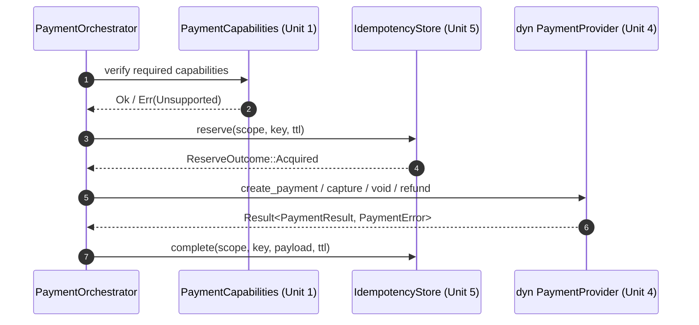

# User Story `US-1.2.0`: `PaymentProvider` SPI Trait, `PaymentCapabilities`, Canonical Requests/Results & `IdempotencyStore`

- **Module**: `module-1-core-contracts` (Core Contracts (`some-payment-core`))
- **Story Branch**: `feat/us-1.2.0-provider-spi-and-idempotency-contracts`
- **Field Profile**: `software`
- **Story Decomposition Score ($S_{\text{story}}$)**: `2.80` $\to$ **`5` Parallel Implementation Units (`unit-1..5`)**

---

## 1. Spec Kit Specifications

### 1.1 User Story Narrative
> **As a** payment orchestrator author and third-party gateway maintainer,  
> **I want** the canonical `PaymentProvider` async trait, `PaymentCapabilities` bitmask, normalized request/result/webhook DTOs, and `IdempotencyStore` trait in `some-payment-core`,  
> **So that** `some-stripe`, `some-moyasar`, `some-paymob`, and future providers can plug into `some-payment` with fail-closed capability checks and uniform webhook/idempotency contracts.

Defines the exact Service Provider Interface (SPI) and distributed idempotency trait from `docs/sdk-implementation.md` so any provider crate can implement `PaymentProvider` without depending on `some-payment`.

#### 1.1.1 Preconditions
- `US-1.1.0` domain primitives are seeded or merged on `feat/module-1-core-contracts`.

#### 1.1.2 Postconditions
- `PaymentProvider` is object-safe (`Arc<dyn PaymentProvider>`) with fail-closed default methods returning `PaymentError::Unsupported`.
- `PaymentCapabilities` models all 14 capability flags.
- `NormalizedWebhookEvent` supports `VerificationChallenge` and scrubbed `raw_redacted` payload.
- `IdempotencyStore` defines `reserve`, `complete`, and `release` with `ReserveOutcome`.

### 1.2 Acceptance Criteria (Gherkin Scenarios)
```gherkin
Feature: PaymentProvider SPI, Capabilities & IdempotencyStore Contracts

  Scenario: AC-1 — Fail-closed default methods on PaymentProvider
    Given a minimal PaymentProvider implementing only create_payment, get_payment, and parse_and_verify_webhook
    When capture, void_payment, refund, or create_checkout is invoked
    Then each returns Err(PaymentError::Unsupported) naming the provider ID and operation

  Scenario: AC-2 — Capability bitmask declares exact supported operations
    Given a provider claiming HOSTED_CHECKOUT | REFUND | PARTIAL_REFUND
    When capabilities().contains(AUTH_CAPTURE) is queried
    Then it returns false so the orchestrator fails closed before network I/O

  Scenario: AC-3 — NextAction discriminates redirect, embedded secret, OTP, and offline bill
    Given a Moyasar STC Pay initiated response or Stripe PaymentIntent client_secret
    When represented via NextAction
    Then STC Pay maps to NextAction::OtpChallenge and Stripe maps to NextAction::EmbeddedClientSecret

  Scenario: AC-4 — IdempotencyStore contract models atomic lock lifecycle
    Given an IdempotencyStore implementation returning ReserveOutcome::InProgress
    When a concurrent worker attempts the same mutation key
    Then it maps to PaymentError::IdempotencyConflict without invoking the provider
```

### 1.3 Test Cases & Traceability Matrix

| Test Case ID | Mapped AC | Owning Unit | Test Level | Description & Input Vector | Expected Result & Pass Threshold |
| :--- | :---: | :---: | :---: | :--- | :--- |
| `TC-1.2.1` | `AC-2` | `unit-1` | Unit | Bitmask union/intersection across all 14 `PaymentCapabilities` flags | Exact bit membership & empty default |
| `TC-1.2.2` | `AC-1` | `unit-2` | Unit | Build `CreatePaymentRequest`, `CheckoutSessionRequest`, `CaptureRequest`, `VoidRequest`, `RefundRequest` | Validated builders and metadata bounds |
| `TC-1.2.3` | `AC-3` | `unit-3` | Unit | Construct `PaymentResult`, `NextAction`, `RawWebhookRequest`, `NormalizedWebhookEvent` | Lossless serde + static lookup table for `PaymentStatus` |
| `TC-1.2.4` | `AC-1` | `unit-4` | Unit | Dummy `Arc<dyn PaymentProvider>` object-safety & default method calls | Compiles as trait object; defaults return `Unsupported` |
| `TC-1.2.5` | `AC-4` | `unit-5` | Unit | Mock `Arc<dyn IdempotencyStore>` covering `Acquired`, `Completed`, `InProgress` | Object-safe async trait contract verified |

---

## 2. Technical Implementation Plan

### 2.1 Domain Invariants & Storage Schema
- **Object Safety**: `PaymentProvider: Send + Sync + Debug` and `IdempotencyStore: Send + Sync` usable behind `Arc<dyn ...>`.
- **Canonical `PaymentStatus`**: 13 statuses mapped via static `const` lookup table (`CC <= 3`).
- **Raw Webhook Bytes**: `RawWebhookRequest` stores unparsed `Vec<u8>` raw bytes, headers, query params, and HTTP method (`GET`/`POST`).

### 2.2 Sequence Diagram


---

## 3. Expected Folder Architecture at the Project

```text
crates/some-payment-core/src/
├── lib.rs              # Seeded on Module 1 base branch
├── capabilities.rs     # Owned exclusively by unit-1
├── requests.rs         # Owned exclusively by unit-2
├── results.rs          # Owned exclusively by unit-3
├── provider.rs         # Owned exclusively by unit-4
└── idempotency.rs      # Owned exclusively by unit-5
```

---

## 4. Implementation Units in Detail & Specialist Agent Assignment

### 4.1 Story Decomposition Score ($S_{\text{story}}$) & Dynamic Unit Count ($K$)
- **$D_1$ (35% Surface)**: `3` — 5 core contract surfaces (capabilities, requests, results/webhooks, `PaymentProvider`, `IdempotencyStore`)
- **$D_2$ (25% Volume)**: `3` — ~750–950 production LOC + doc-tests
- **$D_3$ (20% Complexity)**: `2` — Trait object safety (`Arc<dyn Trait>`), 14-flag bitmask, discriminated `NextAction` & webhook envelopes
- **$D_4$ (20% Boundaries)**: `3` — 5 disjoint Rust modules under `crates/some-payment-core/src/`
- **Calculated Score**: $S_{\text{story}} = 0.35(3) + 0.25(3) + 0.20(2) + 0.20(3) = \mathbf{2.80}$ $\to$ **`5` Parallel Units**

### 4.2 Detailed Unit Specifications (`unit-1..5`)
- **`unit-1` (`feat/us-1.2.0/unit-1-capabilities`)**:
  - **Deliverable Scope**: `PaymentCapabilities` bitflags covering all 14 capability flags
  - **Owned Files**: `crates/some-payment-core/src/capabilities.rs`
  - **Public Contract / Exports**: `PaymentCapabilities`
  - **Unit Verification & Target Complexity**: Unit tests + doc-tests for `crates/some-payment-core/src/capabilities.rs`, Max Cyclomatic Complexity $CC \le 6$ (cap $\le 10$, nesting $\le 2$)
- **`unit-2` (`feat/us-1.2.0/unit-2-requests`)**:
  - **Deliverable Scope**: Canonical request DTOs (`CreatePaymentRequest`, `CheckoutSessionRequest`, `CaptureRequest`, `VoidRequest`, `RefundRequest`, `CaptureMode`, `SplitInstruction`)
  - **Owned Files**: `crates/some-payment-core/src/requests.rs`
  - **Public Contract / Exports**: All request structs & builders
  - **Unit Verification & Target Complexity**: Unit tests + doc-tests for `crates/some-payment-core/src/requests.rs`, Max Cyclomatic Complexity $CC \le 6$ (cap $\le 10$, nesting $\le 2$)
- **`unit-3` (`feat/us-1.2.0/unit-3-results`)**:
  - **Deliverable Scope**: `PaymentResult`, `RefundResult`, `PaymentStatus`, `NextAction`, `RawWebhookRequest`, `NormalizedWebhookEvent`, `VerificationChallenge`
  - **Owned Files**: `crates/some-payment-core/src/results.rs`
  - **Public Contract / Exports**: All result & webhook DTOs
  - **Unit Verification & Target Complexity**: Unit tests + doc-tests for `crates/some-payment-core/src/results.rs`, Max Cyclomatic Complexity $CC \le 6$ (cap $\le 10$, nesting $\le 2$)
- **`unit-4` (`feat/us-1.2.0/unit-4-provider-trait`)**:
  - **Deliverable Scope**: `#[async_trait] pub trait PaymentProvider: Send + Sync + Debug` with fail-closed default methods
  - **Owned Files**: `crates/some-payment-core/src/provider.rs`
  - **Public Contract / Exports**: `PaymentProvider`
  - **Unit Verification & Target Complexity**: Unit tests + doc-tests for `crates/some-payment-core/src/provider.rs`, Max Cyclomatic Complexity $CC \le 6$ (cap $\le 10$, nesting $\le 2$)
- **`unit-5` (`feat/us-1.2.0/unit-5-idempotency-trait`)**:
  - **Deliverable Scope**: `ReserveOutcome` and `#[async_trait] pub trait IdempotencyStore: Send + Sync`
  - **Owned Files**: `crates/some-payment-core/src/idempotency.rs`
  - **Public Contract / Exports**: `IdempotencyStore`, `ReserveOutcome`
  - **Unit Verification & Target Complexity**: Unit tests + doc-tests for `crates/some-payment-core/src/idempotency.rs`, Max Cyclomatic Complexity $CC \le 6$ (cap $\le 10$, nesting $\le 2$)

### 4.3 Best-Fit Specialist Agents per Unit (`msitarzewski/agency-agents` + Core Roster)

| Unit ID | Branch Name | Primary Implementer Agent(s) (`agency-catalog`) | Reviewing Council Agent(s) | Mandatory Skills Enforced |
| :--- | :--- | :--- | :--- | :--- |
| `unit-1` | `feat/us-1.2.0/unit-1-capabilities` | `backend-architect` | `code-reviewer`, `application-security-engineer`, `test-automation-engineer` | `code-review-council`, `security-audit`, `cyclomatic-complexity` |
| `unit-2` | `feat/us-1.2.0/unit-2-requests` | `api-platform-engineer` | `code-reviewer`, `security-architect`, `test-automation-engineer` | `code-review-council`, `security-audit`, `cyclomatic-complexity` |
| `unit-3` | `feat/us-1.2.0/unit-3-results` | `api-platform-engineer` | `code-reviewer`, `security-architect`, `test-automation-engineer` | `code-review-council`, `security-audit`, `cyclomatic-complexity` |
| `unit-4` | `feat/us-1.2.0/unit-4-provider-trait` | `backend-architect` | `code-reviewer`, `application-security-engineer`, `test-automation-engineer` | `code-review-council`, `security-audit`, `cyclomatic-complexity` |
| `unit-5` | `feat/us-1.2.0/unit-5-idempotency-trait` | `backend-architect` | `code-reviewer`, `security-architect`, `test-automation-engineer` | `code-review-council`, `security-audit`, `cyclomatic-complexity` |
| **Story Remediation** | `patch/us-1.2.0-fixes` | `patch-implementer` | `code-reviewer-council-president` | Full 6-Gate Re-Verification |

### 4.4 Parallel Execution & Zero-Blocking Contract Seeding Plan
1. **Base Contract Seeding**: Seed module declarations in `crates/some-payment-core/src/lib.rs` on `feat/module-1-core-contracts` before branching.
2. **Simultaneous Worktree Spawning**: All 5 units are provisioned in `.worktrees/feat-us-1.2.0-provider-spi-and-idempotency-contracts-unit-1..5` and spawned simultaneously in Wave 2.
3. **Ordered Cascading Merge Sequence**: `unit-1` $\to$ `unit-2` $\to$ `unit-3` $\to$ `unit-4` $\to$ `unit-5` into `feat/us-1.2.0-provider-spi-and-idempotency-contracts` via `gh pr merge <PR> --merge`.

---

## 5. Security Gateway (Powered by `security-audit` Skill)

### 5.1 Trust Boundaries & Security Actors
- **Security Actors**: Orchestrator callers, external webhook senders, provider adapter authors.
- **Trust Boundaries**: `RawWebhookRequest` raw byte ingestion; `NextAction::EmbeddedClientSecret` secret redaction; `IdempotencyStore` lock-release rules.

### 5.2 Threat Modeling & Abuse Matrix (STRIDE / OWASP ASVS)

| Threat ID | STRIDE Category | ASVS / CWE Ref | Attack Vector / Abuse Scenario | Impact | Required Mitigation & Code Control |
| :--- | :---: | :---: | :--- | :---: | :--- |
| `TM-1` | **S**poofing | ASVS V2 / CWE-345 | Pre-parsed JSON passed to webhook verifier bypassing raw-byte HMAC | Critical | `RawWebhookRequest` accepts `Vec<u8>` raw bytes exclusively |
| `TM-2` | **T**ampering | ASVS V5 / CWE-20 | Calling unsupported `Manual` capture on non-capable provider | High | Mandatory `PaymentCapabilities` bitmask check before dispatch |
| `TM-3` | **R**epudiation | ASVS V7 / CWE-778 | Missing `event_id` or `livemode` on normalized webhooks | Medium | Required `event_id` and `livemode: bool` fields |
| `TM-4` | **I**nformation Disclosure | ASVS V8 / CWE-200 | Logging `client_secret` or webhook `secret_token` | Critical | Custom `Debug` redacts `client_secret`; `raw_redacted` forbids secrets |
| `TM-5` | **D**enial of Service | ASVS V11 / CWE-400 | Unbounded metadata map or splits array | Medium | Enforce metadata entry/length bounds and split count caps |
| `TM-6` | **E**levation of Privilege | ASVS V4 / CWE-285 | Releasing idempotency lock on 5xx timeout causing double refund | Critical | Explicit contract forbidding `release()` on 5xx/timeouts |

### 5.3 Cryptography & Global Data Protection Controls (Worldwide Legal & Regulatory Compliance)
1. **Cryptographic Standards**: TLS 1.2/1.3+ in transit; constant-time comparison (`subtle::ConstantTimeEq`) for all HMAC digests and secret tokens; `SHA-256`/`SHA-512` only; zero hardcoded secrets or weak hashes (`MD5`/`SHA-1`).
2. **Global Multi-Jurisdictional Privacy & Legal Compliance**: Supports PCI-DSS v4.0 (zero raw PANs in logs/errors/server-side defaults), GDPR / UK GDPR, CCPA/CPRA, and regional MENA payment sovereignty (SA/EG/AE/OM/PK) via automatic `[REDACTED]` PII/secret scrubbing across UTF-8 logs and telemetry.

### 5.4 Automated Security Verification Checklist (`cloudflare/security-audit-skill`)
- [ ] Applicable `skills/security-audit/playbooks/` reviewed (`WEB-PROTOCOL-AND-AUTH.md`, `MEMORY-SAFETY-AND-BINARY.md`, `SUPPLY-CHAIN-AND-RELEASE.md`).
- [ ] All untrusted inputs validated for type, length, range, and encoding prior to domain processing.
- [ ] Zero secrets, API keys, private keys, or raw PII emitted in `Debug` formatting, logs, or error messages.
- [ ] Zero `unsafe` blocks and zero `f32`/`f64` floats for monetary calculations.

### 5.5 Security Gateway (Gate G2) Sign-Off Checklist
- [ ] **0 Critical / High / Medium** vulnerabilities in `security-audit` scan.
- [ ] All STRIDE / ASVS threat mitigations (`TM-1..TM-6`) implemented and covered by negative/security test cases in Section 1.3.
- [ ] Independent Security Reviewer agent sign-off posted to the GitHub PR conversation.

---

## 6. Validation Gates & Acceptance Sign-Off

| Gate | Gate Name | Pass Criteria for `US-1.2.0` | Verification Command / Evidence | Status |
| :--- | :--- | :--- | :--- | :---: |
| **Gate G0** | **Build, Lint & Format** | 0 errors, 0 warnings, 100% `rustfmt` compliance | `CARGO_BUILD_JOBS=1 cargo fmt --check && cargo clippy -p some-payment-core --all-targets -- -D warnings` | `[ ]` |
| **Gate G1** | **Tests, Coverage & Traceability** | 100% of `AC-*` and `TC-*` passing ($\ge 90\%$ line, $\ge 85\%$ branch coverage) | `CARGO_BUILD_JOBS=1 cargo test -p some-payment-core` | `[ ]` |
| **Gate G2** | **Security Gateway (`security-audit`)** | All Section 5 STRIDE, crypto, and global compliance checks pass (0 findings) | `security-audit` report on PR | `[ ]` |
| **Gate G-Complexity** | **Cyclomatic Complexity** | Every function $CC \le 6$ target ($CC \le 10$ ceiling, $CC > 15$ blocker, nesting $\le 2$) | `cyclomatic-complexity` table on PR | `[ ]` |
| **Gate G-Docs** | **Documentation & Doc-Tests** | 100% public symbols documented + runnable doc-tests pass | `CARGO_BUILD_JOBS=1 cargo test --doc -p some-payment-core` | `[ ]` |
| **Gate G-Review** | **Council President Sign-Off** | Independent Reviewing Council posts `GATE G-REVIEW APPROVED` on GitHub PR | `gh pr comment <PR>` | `[ ]` |

### Final Acceptance Sign-Off Block
- **Story Leader Verification**: All 5 units merged via cascading `gh pr merge`, story integration suite green, and zero unaddressed findings.
- **Reviewing Council Verdict**: `PENDING` $\to$ `GATE G-REVIEW APPROVED`
