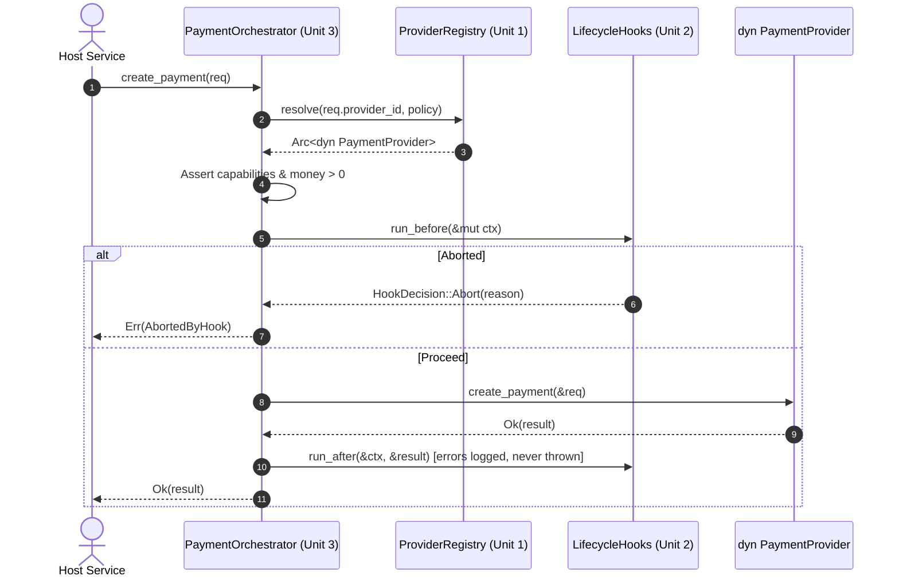

# User Story `US-2.1.0`: Thread-Safe `ProviderRegistry`, Five-Step Execution Pipeline & Composable `LifecycleHooks`

- **Module**: `module-2-orchestrator-routing` (Orchestrator, Registry, Hooks & Routing)
- **Story Branch**: `feat/us-2.1.0-registry-hooks-and-orchestrator-pipeline`
- **Field Profile**: `software`
- **Story Decomposition Score ($S_{\text{story}}$)**: `2.55` $\to$ **`4` Parallel Implementation Units (`unit-1..4`)**

---

## 1. Spec Kit Specifications

### 1.1 User Story Narrative
> **As a** backend engineer integrating multiple payment gateways into a single service,  
> **I want** a provider-agnostic `PaymentOrchestrator` backed by a thread-safe `ProviderRegistry` and composable `before`/`after`/`on_error` `LifecycleHooks`,  
> **So that** every payment call enforces capability guards, runs audit/fraud hooks uniformly, and never masks a succeeded charge when an `after` hook fails.

Implements the core five-step template method (`resolve -> capability & money guards -> before hooks -> provider call -> after/on_error hooks`) with zero references to concrete providers.

#### 1.1.1 Preconditions
- `module-1-core-contracts` (`some-payment-core`) is merged on `main`.

#### 1.1.2 Postconditions
- All 6 orchestrator operations execute the 5-step pipeline uniformly.
- Failing `after` hooks log a reconciliation alert and still return `Ok(PaymentResult)`.
- Zero concrete provider references exist in `src/{registry,hooks,orchestrator,builder}.rs`.

### 1.2 Acceptance Criteria (Gherkin Scenarios)
```gherkin
Feature: PaymentOrchestrator Five-Step Pipeline & Lifecycle Hooks

  Scenario: AC-1 — Fail closed before network when capability is unclaimed
    Given a registered mock provider without AUTH_CAPTURE capability
    When create_payment is called with CaptureMode::Manual
    Then PaymentOrchestrator returns Err(PaymentError::Unsupported) with 0 provider calls

  Scenario: AC-2 — Before hook aborts payment prior to gateway invocation
    Given a before hook returning HookDecision::Abort("fraud_score_high")
    When create_payment is called
    Then PaymentOrchestrator returns Err(PaymentError::AbortedByHook) with 0 provider calls

  Scenario: AC-3 — Failing after hook preserves succeeded PaymentResult
    Given a provider whose create_payment succeeds and an after hook returning Err
    When create_payment is called
    Then PaymentOrchestrator logs a structured reconciliation alert and returns Ok(PaymentResult)

  Scenario: AC-4 — Unknown explicit provider_id fails with ConfigurationError
    Given a registry containing only "stripe"
    When create_payment specifies provider_id "unknown"
    Then PaymentOrchestrator returns Err(PaymentError::ConfigurationError)
```

### 1.3 Test Cases & Traceability Matrix

| Test Case ID | Mapped AC | Owning Unit | Test Level | Description & Input Vector | Expected Result & Pass Threshold |
| :--- | :---: | :---: | :---: | :--- | :--- |
| `TC-2.1.1` | `AC-4` | `unit-1` | Unit | Concurrent `ProviderRegistry` lookups & duplicate-registration rejection | Zero lock contention; `ConfigurationError` on miss/duplicate |
| `TC-2.1.2` | `AC-2, AC-3` | `unit-2` | Unit | Sequential `before` abort & `after` error isolation | `before` short-circuits; `after` never returns `Err` |
| `TC-2.1.3` | `AC-1` | `unit-3` | Integration | 5-step pipeline across create/checkout/get/capture/void/refund | Capability guards fail closed; `on_error` fires on provider error |
| `TC-2.1.4` | `AC-4` | `unit-4` | Unit | `PaymentOrchestrator::builder()` empty registry or invalid default | Deterministic `ConfigurationError` at startup |

---

## 2. Technical Implementation Plan

### 2.1 Domain Invariants & Storage Schema
- **Immutable Post-Build Registry**: `Arc<HashMap<ProviderId, Arc<dyn PaymentProvider>>>` eliminates runtime lock contention.
- **Non-Reversible Post-Charge Boundary**: Failing `after` hooks MUST NEVER convert a succeeded charge into `Err`.

### 2.2 Sequence Diagram


---

## 3. Expected Folder Architecture at the Project

```text
src/
├── lib.rs              # Seeded on Module 2 base branch
├── registry.rs         # Owned exclusively by unit-1
├── hooks.rs            # Owned exclusively by unit-2
├── orchestrator.rs     # Owned exclusively by unit-3
└── builder.rs          # Owned exclusively by unit-4
```

---

## 4. Implementation Units in Detail & Specialist Agent Assignment

### 4.1 Story Decomposition Score ($S_{\text{story}}$) & Dynamic Unit Count ($K$)
- **$D_1$ (35% Surface)**: `3` — Registry, Hook chain, 6-operation Orchestrator pipeline, Builder
- **$D_2$ (25% Volume)**: `2` — ~550–700 production LOC
- **$D_3$ (20% Complexity)**: `2` — Async hook execution, pre-flight capability guards, non-reversible `after`-hook isolation
- **$D_4$ (20% Boundaries)**: `3` — 4 disjoint files (`registry.rs`, `hooks.rs`, `orchestrator.rs`, `builder.rs`)
- **Calculated Score**: $S_{\text{story}} = 0.35(3) + 0.25(2) + 0.20(2) + 0.20(3) = \mathbf{2.55}$ $\to$ **`4` Parallel Units**

### 4.2 Detailed Unit Specifications (`unit-1..4`)
- **`unit-1` (`feat/us-2.1.0/unit-1-registry`)**:
  - **Deliverable Scope**: Thread-safe `ProviderRegistry` (`ProviderId -> Arc<dyn PaymentProvider>`) with capability queries & default provider
  - **Owned Files**: `src/registry.rs`
  - **Public Contract / Exports**: `ProviderRegistry`
  - **Unit Verification & Target Complexity**: Unit tests + doc-tests for `src/registry.rs`, Max Cyclomatic Complexity $CC \le 6$ (cap $\le 10$, nesting $\le 2$)
- **`unit-2` (`feat/us-2.1.0/unit-2-hooks`)**:
  - **Deliverable Scope**: Composable `before`/`after`/`on_error` `LifecycleHook` trait, `HookDecision::Abort`, non-reversible `after`-hook isolation
  - **Owned Files**: `src/hooks.rs`
  - **Public Contract / Exports**: `LifecycleHook`, `HookChain`, `HookContext`, `HookDecision`
  - **Unit Verification & Target Complexity**: Unit tests + doc-tests for `src/hooks.rs`, Max Cyclomatic Complexity $CC \le 6$ (cap $\le 10$, nesting $\le 2$)
- **`unit-3` (`feat/us-2.1.0/unit-3-orchestrator`)**:
  - **Deliverable Scope**: `PaymentOrchestrator` five-step execution pipeline across all 6 core operations
  - **Owned Files**: `src/orchestrator.rs`
  - **Public Contract / Exports**: `PaymentOrchestrator`, `PaymentHub`
  - **Unit Verification & Target Complexity**: Unit tests + doc-tests for `src/orchestrator.rs`, Max Cyclomatic Complexity $CC \le 6$ (cap $\le 10$, nesting $\le 2$)
- **`unit-4` (`feat/us-2.1.0/unit-4-builder`)**:
  - **Deliverable Scope**: `PaymentOrchestratorBuilder` with startup validation & duplicate-provider rejection
  - **Owned Files**: `src/builder.rs`
  - **Public Contract / Exports**: `PaymentOrchestratorBuilder`
  - **Unit Verification & Target Complexity**: Unit tests + doc-tests for `src/builder.rs`, Max Cyclomatic Complexity $CC \le 6$ (cap $\le 10$, nesting $\le 2$)

### 4.3 Best-Fit Specialist Agents per Unit (`msitarzewski/agency-agents` + Core Roster)

| Unit ID | Branch Name | Primary Implementer Agent(s) (`agency-catalog`) | Reviewing Council Agent(s) | Mandatory Skills Enforced |
| :--- | :--- | :--- | :--- | :--- |
| `unit-1` | `feat/us-2.1.0/unit-1-registry` | `backend-architect` | `code-reviewer`, `application-security-engineer`, `test-automation-engineer` | `code-review-council`, `security-audit`, `cyclomatic-complexity` |
| `unit-2` | `feat/us-2.1.0/unit-2-hooks` | `backend-architect` | `code-reviewer`, `security-architect`, `test-automation-engineer` | `code-review-council`, `security-audit`, `cyclomatic-complexity` |
| `unit-3` | `feat/us-2.1.0/unit-3-orchestrator` | `backend-architect` | `code-reviewer`, `application-security-engineer`, `test-automation-engineer` | `code-review-council`, `security-audit`, `cyclomatic-complexity` |
| `unit-4` | `feat/us-2.1.0/unit-4-builder` | `api-platform-engineer` | `code-reviewer`, `security-architect`, `test-automation-engineer` | `code-review-council`, `security-audit`, `cyclomatic-complexity` |
| **Story Remediation** | `patch/us-2.1.0-fixes` | `patch-implementer` | `code-reviewer-council-president` | Full 6-Gate Re-Verification |

### 4.4 Parallel Execution & Zero-Blocking Contract Seeding Plan
1. **Base Contract Seeding**: Seed root `Cargo.toml` and `src/lib.rs` declaring `registry`, `hooks`, `orchestrator`, `builder` on `feat/module-2-orchestrator-routing` before branching.
2. **Simultaneous Worktree Spawning**: All 4 units are provisioned in `.worktrees/feat-us-2.1.0-registry-hooks-and-orchestrator-pipeline-unit-1..4` and spawned simultaneously in Wave 2.
3. **Ordered Cascading Merge Sequence**: `unit-1` $\to$ `unit-2` $\to$ `unit-3` $\to$ `unit-4` into `feat/us-2.1.0-registry-hooks-and-orchestrator-pipeline` via `gh pr merge <PR> --merge`.

---

## 5. Security Gateway (Powered by `security-audit` Skill)

### 5.1 Trust Boundaries & Security Actors
- **Security Actors**: Host backend services, custom fraud/audit hooks, registered gateway providers.
- **Trust Boundaries**: `before` hook metadata enrichment; `after` hook isolation from financial result return.

### 5.2 Threat Modeling & Abuse Matrix (STRIDE / OWASP ASVS)

| Threat ID | STRIDE Category | ASVS / CWE Ref | Attack Vector / Abuse Scenario | Impact | Required Mitigation & Code Control |
| :--- | :---: | :---: | :--- | :---: | :--- |
| `TM-1` | **S**poofing | ASVS V4 / CWE-285 | Duplicate provider registration silently replacing a trusted provider | High | Reject duplicate `ProviderId` in `Builder::register` |
| `TM-2` | **T**ampering | ASVS V5 / CWE-20 | `before` hook mutating transaction amount silently | High | Expose `Money` as immutable `&Money` in `HookContext` |
| `TM-3` | **R**epudiation | ASVS V7 / CWE-778 | Swallowed `after` hook failure without operator alert | High | Emit structured `tracing::error!` reconciliation event |
| `TM-4` | **I**nformation Disclosure | ASVS V8 / CWE-200 | Hooks logging secrets or cardholder data | Critical | Pass only redacted summaries inside `HookContext` |
| `TM-5` | **D**enial of Service | ASVS V11 / CWE-400 | Throwing after real charge triggers upstream retries & double charges | Critical | Non-reversible `after` boundary always returns `Ok(result)` |
| `TM-6` | **E**levation of Privilege | ASVS V4 / CWE-285 | Bypassing `before` fraud hook on fallback path | High | Always run `before` hooks prior to any gateway dispatch |

### 5.3 Cryptography & Global Data Protection Controls (Worldwide Legal & Regulatory Compliance)
1. **Cryptographic Standards**: TLS 1.2/1.3+ in transit; constant-time comparison (`subtle::ConstantTimeEq`) for all HMAC digests and secret tokens; `SHA-256`/`SHA-512` only; zero hardcoded secrets or weak hashes (`MD5`/`SHA-1`).
2. **Global Multi-Jurisdictional Privacy & Legal Compliance**: Supports PCI-DSS v4.0 (zero raw PANs in logs/errors/server-side defaults), GDPR / UK GDPR, CCPA/CPRA, and regional MENA payment sovereignty (SA/EG/AE/OM/PK) via automatic `[REDACTED]` PII/secret scrubbing across UTF-8 logs and telemetry.

### 5.4 Automated Security Verification Checklist (`cloudflare/security-audit-skill`)
- [ ] Applicable `skills/security-audit/playbooks/` reviewed (`WEB-PROTOCOL-AND-AUTH.md`, `MEMORY-SAFETY-AND-BINARY.md`, `SUPPLY-CHAIN-AND-RELEASE.md`).
- [ ] All untrusted inputs validated for type, length, range, and encoding prior to domain processing.
- [ ] Zero secrets, API keys, private keys, or raw PII emitted in `Debug` formatting, logs, or error messages.
- [ ] Zero `unsafe` blocks and zero `f32`/`f64` floats for monetary calculations.

### 5.5 Security Gateway (Gate G2) Sign-Off Checklist
- [ ] **0 Critical / High / Medium** vulnerabilities in `security-audit` scan.
- [ ] All STRIDE / ASVS threat mitigations (`TM-1..TM-6`) implemented and covered by negative/security test cases in Section 1.3.
- [ ] Independent Security Reviewer agent sign-off posted to the GitHub PR conversation.

---

## 6. Validation Gates & Acceptance Sign-Off

| Gate | Gate Name | Pass Criteria for `US-2.1.0` | Verification Command / Evidence | Status |
| :--- | :--- | :--- | :--- | :---: |
| **Gate G0** | **Build, Lint & Format** | 0 errors, 0 warnings, 100% `rustfmt` compliance | `CARGO_BUILD_JOBS=1 cargo fmt --check && cargo clippy --all-targets -- -D warnings` | `[ ]` |
| **Gate G1** | **Tests, Coverage & Traceability** | 100% of `AC-*` and `TC-*` passing ($\ge 90\%$ line, $\ge 85\%$ branch coverage) | `CARGO_BUILD_JOBS=1 cargo test` | `[ ]` |
| **Gate G2** | **Security Gateway (`security-audit`)** | All Section 5 STRIDE, crypto, and global compliance checks pass (0 findings) | `security-audit` report on PR | `[ ]` |
| **Gate G-Complexity** | **Cyclomatic Complexity** | Every function $CC \le 6$ target ($CC \le 10$ ceiling, $CC > 15$ blocker, nesting $\le 2$) | `cyclomatic-complexity` table on PR | `[ ]` |
| **Gate G-Docs** | **Documentation & Doc-Tests** | 100% public symbols documented + runnable doc-tests pass | `CARGO_BUILD_JOBS=1 cargo test --doc` | `[ ]` |
| **Gate G-Review** | **Council President Sign-Off** | Independent Reviewing Council posts `GATE G-REVIEW APPROVED` on GitHub PR | `gh pr comment <PR>` | `[ ]` |

### Final Acceptance Sign-Off Block
- **Story Leader Verification**: All 4 units merged via cascading `gh pr merge`, story integration suite green, and zero unaddressed findings.
- **Reviewing Council Verdict**: `PENDING` $\to$ `GATE G-REVIEW APPROVED`
