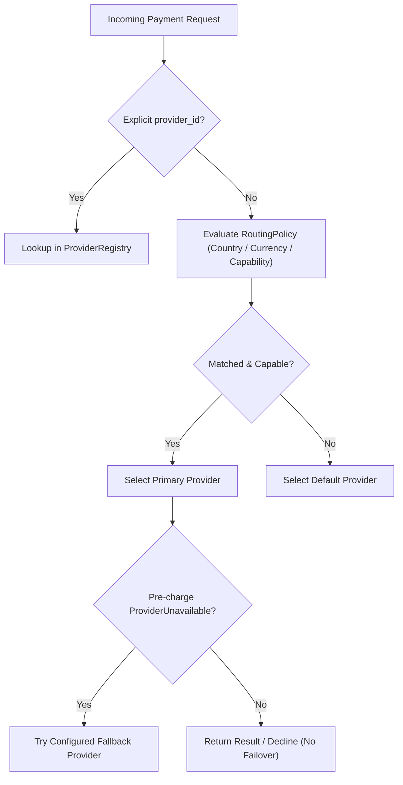

# User Story `US-2.2.0`: Deterministic `RoutingPolicy` Engine, Country/Currency Routing & Composable Cross-Gateway Pipelines

- **Module**: `module-2-orchestrator-routing` (Orchestrator, Registry, Hooks & Routing)
- **Story Branch**: `feat/us-2.2.0-routing-policies-and-composable-pipelines`
- **Field Profile**: `software`
- **Story Decomposition Score ($S_{\text{story}}$)**: `2.20` $\to$ **`4` Parallel Implementation Units (`unit-1..4`)**

---

## 1. Spec Kit Specifications

### 1.1 User Story Narrative
> **As a** global & MENA marketplace architect,  
> **I want** deterministic country/currency routing (`SAR`/`SA` -> `moyasar`, `EGP`/`EG` -> `paymob`, international -> `stripe`), safe pre-charge failover, and composable cross-gateway pipelines,  
> **So that** payments route to the optimal regional gateway while supporting explicit overrides and mix-and-match provider composition.

Implements pure, deterministic routing policies inspired by `@paykernel/routing` and Hyperswitch, plus `ComposablePipeline` from `some-payment/README.md`.

#### 1.1.1 Preconditions
- `ProviderRegistry` and `PaymentProvider` trait are available.

#### 1.1.2 Postconditions
- Explicit per-call `provider_id` always overrides routing policies.
- Fallback triggers strictly on pre-charge `ProviderUnavailable` (never on `CardDeclined` or ambiguous timeout).
- `ComposablePipeline` validates all pinned providers at build time.

### 1.2 Acceptance Criteria (Gherkin Scenarios)
```gherkin
Feature: Deterministic Routing Policies & Composable Pipelines

  Scenario: AC-1 — Regional currency routing selects optimal provider
    Given a registry with stripe, moyasar, and paymob registered
    When RegionalCurrencyRouter selects for SAR, EGP, and USD requests
    Then SAR routes to moyasar, EGP routes to paymob, and USD routes to stripe

  Scenario: AC-2 — Explicit per-call override takes absolute precedence
    Given a SAR request with explicit provider_id = "stripe"
    When provider resolution runs
    Then stripe is selected instead of moyasar

  Scenario: AC-3 — Safe failover triggers only on pre-charge ProviderUnavailable
    Given UAE configured with primary paymob and fallback stripe
    When paymob returns ProviderUnavailable (pre-charge 503)
    Then FallbackPolicy fails over to stripe
    And when paymob returns CardDeclined it does NOT fail over

  Scenario: AC-4 — ComposablePipeline validates pinned providers at build time
    Given a ComposablePipeline pinning an unregistered provider ID
    When build() is called
    Then it returns Err(PaymentError::ConfigurationError)
```

### 1.3 Test Cases & Traceability Matrix

| Test Case ID | Mapped AC | Owning Unit | Test Level | Description & Input Vector | Expected Result & Pass Threshold |
| :--- | :---: | :---: | :---: | :--- | :--- |
| `TC-2.2.1` | `AC-2` | `unit-1` | Unit | `RoutingPolicy::select` explicit override vs policy | Override always takes precedence |
| `TC-2.2.2` | `AC-1` | `unit-2` | Unit | `RegionalCurrencyRouter` & `CountryRoutingPolicy` static lookup table | `SAR`/`SA`->`moyasar`, `EGP`/`EG`->`paymob`, `USD`/`US`->`stripe` |
| `TC-2.2.3` | `AC-3` | `unit-3` | Unit + Negative | Failover on `ProviderUnavailable` vs `CardDeclined` / timeout + cyclic chain guard | Fails over only on pre-charge unavailable; cyclic chain bounded <= 3 hops |
| `TC-2.2.4` | `AC-4` | `unit-4` | Unit | `ComposablePipeline` builder with valid vs missing providers | Fails closed at build time on missing provider |

---

## 2. Technical Implementation Plan

### 2.1 Domain Invariants & Storage Schema
- **Pure Selection**: `RoutingPolicy::select` performs zero network I/O.
- **Acyclic Bounded Failover**: Visited-set tracking with max-hop ceiling `<= 3`.

### 2.2 Activity Diagram


---

## 3. Expected Folder Architecture at the Project

```text
src/routing/
├── mod.rs              # Seeded on Module 2 base branch
├── policy.rs           # Owned exclusively by unit-1
├── country_router.rs   # Owned exclusively by unit-2
├── fallback.rs         # Owned exclusively by unit-3
└── pipeline.rs         # Owned exclusively by unit-4
```

---

## 4. Implementation Units in Detail & Specialist Agent Assignment

### 4.1 Story Decomposition Score ($S_{\text{story}}$) & Dynamic Unit Count ($K$)
- **$D_1$ (35% Surface)**: `2` — Policy trait, country/currency router, safe failover, composable pipeline
- **$D_2$ (25% Volume)**: `2` — ~450–600 production LOC
- **$D_3$ (20% Complexity)**: `2` — Deterministic rule precedence, acyclic failover guard, capability verification
- **$D_4$ (20% Boundaries)**: `3` — 4 disjoint files under `src/routing/`
- **Calculated Score**: $S_{\text{story}} = 0.35(2) + 0.25(2) + 0.20(2) + 0.20(3) = \mathbf{2.20}$ $\to$ **`4` Parallel Units**

### 4.2 Detailed Unit Specifications (`unit-1..4`)
- **`unit-1` (`feat/us-2.2.0/unit-1-policy`)**:
  - **Deliverable Scope**: `RoutingPolicy` trait, `RoutingContext`, `DefaultOnlyPolicy`
  - **Owned Files**: `src/routing/policy.rs`
  - **Public Contract / Exports**: `RoutingPolicy`, `RoutingContext`
  - **Unit Verification & Target Complexity**: Unit tests + doc-tests for `src/routing/policy.rs`, Max Cyclomatic Complexity $CC \le 6$ (cap $\le 10$, nesting $\le 2$)
- **`unit-2` (`feat/us-2.2.0/unit-2-country-router`)**:
  - **Deliverable Scope**: `RegionalCurrencyRouter` & `CountryRoutingPolicy` builder using static lookup tables
  - **Owned Files**: `src/routing/country_router.rs`
  - **Public Contract / Exports**: `RegionalCurrencyRouter`, `CountryRoutingPolicy`
  - **Unit Verification & Target Complexity**: Unit tests + doc-tests for `src/routing/country_router.rs`, Max Cyclomatic Complexity $CC \le 6$ (cap $\le 10$, nesting $\le 2$)
- **`unit-3` (`feat/us-2.2.0/unit-3-fallback`)**:
  - **Deliverable Scope**: `FallbackPolicy` with safe pre-charge failover predicate & acyclic hop guard
  - **Owned Files**: `src/routing/fallback.rs`
  - **Public Contract / Exports**: `FallbackPolicy`, `is_safe_failover`
  - **Unit Verification & Target Complexity**: Unit tests + doc-tests for `src/routing/fallback.rs`, Max Cyclomatic Complexity $CC \le 6$ (cap $\le 10$, nesting $\le 2$)
- **`unit-4` (`feat/us-2.2.0/unit-4-pipeline`)**:
  - **Deliverable Scope**: `ComposablePipeline` builder pinning distinct providers per capability domain
  - **Owned Files**: `src/routing/pipeline.rs`
  - **Public Contract / Exports**: `ComposablePipeline`, `ComposablePipelineBuilder`
  - **Unit Verification & Target Complexity**: Unit tests + doc-tests for `src/routing/pipeline.rs`, Max Cyclomatic Complexity $CC \le 6$ (cap $\le 10$, nesting $\le 2$)

### 4.3 Best-Fit Specialist Agents per Unit (`msitarzewski/agency-agents` + Core Roster)

| Unit ID | Branch Name | Primary Implementer Agent(s) (`agency-catalog`) | Reviewing Council Agent(s) | Mandatory Skills Enforced |
| :--- | :--- | :--- | :--- | :--- |
| `unit-1` | `feat/us-2.2.0/unit-1-policy` | `backend-architect` | `code-reviewer`, `application-security-engineer`, `test-automation-engineer` | `code-review-council`, `security-audit`, `cyclomatic-complexity` |
| `unit-2` | `feat/us-2.2.0/unit-2-country-router` | `backend-architect` | `code-reviewer`, `security-architect`, `test-automation-engineer` | `code-review-council`, `security-audit`, `cyclomatic-complexity` |
| `unit-3` | `feat/us-2.2.0/unit-3-fallback` | `backend-architect` | `code-reviewer`, `penetration-tester`, `test-automation-engineer` | `code-review-council`, `security-audit`, `cyclomatic-complexity` |
| `unit-4` | `feat/us-2.2.0/unit-4-pipeline` | `api-platform-engineer` | `code-reviewer`, `security-architect`, `test-automation-engineer` | `code-review-council`, `security-audit`, `cyclomatic-complexity` |
| **Story Remediation** | `patch/us-2.2.0-fixes` | `patch-implementer` | `code-reviewer-council-president` | Full 6-Gate Re-Verification |

### 4.4 Parallel Execution & Zero-Blocking Contract Seeding Plan
1. **Base Contract Seeding**: Seed `src/routing/mod.rs` on `feat/module-2-orchestrator-routing` before branching.
2. **Simultaneous Worktree Spawning**: All 4 units are provisioned in `.worktrees/feat-us-2.2.0-routing-policies-and-composable-pipelines-unit-1..4` and spawned simultaneously in Wave 2.
3. **Ordered Cascading Merge Sequence**: `unit-1` $\to$ `unit-2` $\to$ `unit-3` $\to$ `unit-4` into `feat/us-2.2.0-routing-policies-and-composable-pipelines` via `gh pr merge <PR> --merge`.

---

## 5. Security Gateway (Powered by `security-audit` Skill)

### 5.1 Trust Boundaries & Security Actors
- **Security Actors**: Checkout callers supplying country/currency hints; platform operators configuring routing tables.
- **Trust Boundaries**: Untrusted buyer country/currency inputs crossing into provider selection; failover retry boundary.

### 5.2 Threat Modeling & Abuse Matrix (STRIDE / OWASP ASVS)

| Threat ID | STRIDE Category | ASVS / CWE Ref | Attack Vector / Abuse Scenario | Impact | Required Mitigation & Code Control |
| :--- | :---: | :---: | :--- | :---: | :--- |
| `TM-1` | **S**poofing | ASVS V5 / CWE-20 | Spoofed country header routing into unsupported currency/provider | Medium | Verify selected provider supports required capabilities before dispatch |
| `TM-2` | **T**ampering | ASVS V5 / CWE-20 | Double-charging customer by failing over after ambiguous timeout | Critical | Forbid failover on timeouts, post-send 500s, or `CardDeclined` |
| `TM-3` | **R**epudiation | ASVS V7 / CWE-778 | Unclear which routing rule selected the gateway | Medium | Record chosen `ProviderId` in `PaymentResult` and structured trace |
| `TM-4` | **I**nformation Disclosure | ASVS V8 / CWE-200 | Exposing internal failover topology to end users | Low | Return normalized `PaymentError` without internal table dumps |
| `TM-5` | **D**enial of Service | ASVS V11 / CWE-835 | Cyclic fallback chain (`A -> B -> A`) | High | Enforce acyclic visited-set & max-hop cap (`<= 3`) |
| `TM-6` | **E**levation of Privilege | ASVS V4 / CWE-285 | Unregistered provider returned by custom rule | Medium | Validate against `ProviderRegistry` before returning |

### 5.3 Cryptography & Global Data Protection Controls (Worldwide Legal & Regulatory Compliance)
1. **Cryptographic Standards**: TLS 1.2/1.3+ in transit; constant-time comparison (`subtle::ConstantTimeEq`) for all HMAC digests and secret tokens; `SHA-256`/`SHA-512` only; zero hardcoded secrets or weak hashes (`MD5`/`SHA-1`).
2. **Global Multi-Jurisdictional Privacy & Legal Compliance**: Supports PCI-DSS v4.0 (zero raw PANs in logs/errors/server-side defaults), GDPR / UK GDPR, CCPA/CPRA, and regional MENA payment sovereignty (SA/EG/AE/OM/PK) via automatic `[REDACTED]` PII/secret scrubbing across UTF-8 logs and telemetry.

### 5.4 Automated Security Verification Checklist (`cloudflare/security-audit-skill`)
- [ ] Applicable `skills/security-audit/playbooks/` reviewed (`WEB-PROTOCOL-AND-AUTH.md`, `MEMORY-SAFETY-AND-BINARY.md`, `SUPPLY-CHAIN-AND-RELEASE.md`).
- [ ] All untrusted inputs validated for type, length, range, and encoding prior to domain processing.
- [ ] Zero secrets, API keys, private keys, or raw PII emitted in `Debug` formatting, logs, or error messages.
- [ ] Zero `unsafe` blocks and zero `f32`/`f64` floats for monetary calculations.

### 5.5 Security Gateway (Gate G2) Sign-Off Checklist
- [ ] **0 Critical / High / Medium** vulnerabilities in `security-audit` scan.
- [ ] All STRIDE / ASVS threat mitigations (`TM-1..TM-6`) implemented and covered by negative/security test cases in Section 1.3.
- [ ] Independent Security Reviewer agent sign-off posted to the GitHub PR conversation.

---

## 6. Validation Gates & Acceptance Sign-Off

| Gate | Gate Name | Pass Criteria for `US-2.2.0` | Verification Command / Evidence | Status |
| :--- | :--- | :--- | :--- | :---: |
| **Gate G0** | **Build, Lint & Format** | 0 errors, 0 warnings, 100% `rustfmt` compliance | `CARGO_BUILD_JOBS=1 cargo fmt --check && cargo clippy --all-targets -- -D warnings` | `[ ]` |
| **Gate G1** | **Tests, Coverage & Traceability** | 100% of `AC-*` and `TC-*` passing ($\ge 90\%$ line, $\ge 85\%$ branch coverage) | `CARGO_BUILD_JOBS=1 cargo test` | `[ ]` |
| **Gate G2** | **Security Gateway (`security-audit`)** | All Section 5 STRIDE, crypto, and global compliance checks pass (0 findings) | `security-audit` report on PR | `[ ]` |
| **Gate G-Complexity** | **Cyclomatic Complexity** | Every function $CC \le 6$ target ($CC \le 10$ ceiling, $CC > 15$ blocker, nesting $\le 2$) | `cyclomatic-complexity` table on PR | `[ ]` |
| **Gate G-Docs** | **Documentation & Doc-Tests** | 100% public symbols documented + runnable doc-tests pass | `CARGO_BUILD_JOBS=1 cargo test --doc` | `[ ]` |
| **Gate G-Review** | **Council President Sign-Off** | Independent Reviewing Council posts `GATE G-REVIEW APPROVED` on GitHub PR | `gh pr comment <PR>` | `[ ]` |

### Final Acceptance Sign-Off Block
- **Story Leader Verification**: All 4 units merged via cascading `gh pr merge`, story integration suite green, and zero unaddressed findings.
- **Reviewing Council Verdict**: `PENDING` $\to$ `GATE G-REVIEW APPROVED`
