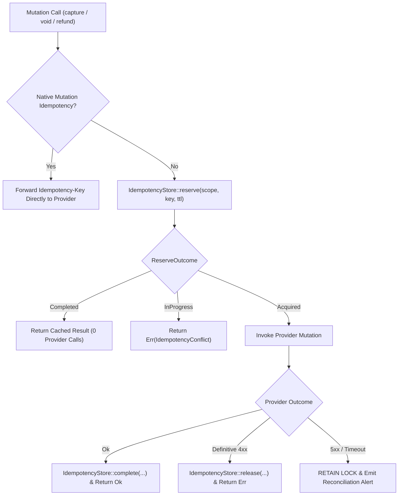

# User Story `US-3.1.0`: Distributed `IdempotencyStore` Boundary, `InMemoryIdempotencyStore` & Safe Lock-Retention Semantics

- **Module**: `module-3-idempotency-webhooks` (Distributed Idempotency Boundary & Unified Webhook Pipeline)
- **Story Branch**: `feat/us-3.1.0-distributed-idempotency-boundary`
- **Field Profile**: `software`
- **Story Decomposition Score ($S_{\text{story}}$)**: `2.25` $\to$ **`4` Parallel Implementation Units (`unit-1..4`)**

---

## 1. Spec Kit Specifications

### 1.1 User Story Narrative
> **As a** production backend engineer operating multi-worker deployments with Moyasar and Paymob,  
> **I want** a pluggable `IdempotencyStore` execution boundary that wraps non-idempotent mutations (`capture`, `void_payment`, `refund`) and retains locks on indeterminate 5xx/timeouts,  
> **So that** network retries or concurrent workers can never trigger duplicate refunds or captures on gateways lacking native mutation idempotency.

Separates creation idempotency (UUID v4 forwarded to Stripe `Idempotency-Key` / Moyasar `given_id`) from distributed post-payment mutation locking backed by Redis/PostgreSQL in production and `InMemoryIdempotencyStore` in tests.

#### 1.1.1 Preconditions
- `IdempotencyStore` trait (`module-1`) and `PaymentOrchestrator` (`module-2`) are merged on `main`.

#### 1.1.2 Postconditions
- Non-idempotent mutations (`!capabilities.contains(NATIVE_MUTATION_IDEMPOTENCY)`) acquire an atomic lock via `IdempotencyStore::reserve`.
- `release()` is invoked ONLY on definitive pre-flight or 4xx rejections — NEVER on 5xx or timeouts.
- Cached `Completed` payloads replay deterministically without hitting the provider.

### 1.2 Acceptance Criteria (Gherkin Scenarios)
```gherkin
Feature: Distributed Idempotency Boundary & Safe Lock Retention

  Scenario: AC-1 — Replay cached response for completed mutation key
    Given an IdempotencyStore where key "refund:ord-1" is already Completed
    When refund() is called again with key "refund:ord-1"
    Then it returns the cached RefundResult with 0 outbound provider calls

  Scenario: AC-2 — Reject concurrent in-flight duplicate with IdempotencyConflict
    Given an IdempotencyStore where key "refund:ord-1" is InProgress
    When a second worker calls refund() with key "refund:ord-1"
    Then it returns Err(PaymentError::IdempotencyConflict) with 0 provider calls

  Scenario: AC-3 — Retain lock on indeterminate 5xx or timeout
    Given a Moyasar refund call that fails with HTTP 504 timeout
    When the idempotency boundary handles the error
    Then IdempotencyStore::release is NOT called and the key remains locked for reconciliation

  Scenario: AC-4 — Release lock on definitive 4xx client validation failure
    Given a Paymob capture call rejected with HTTP 400 validation error
    When the idempotency boundary handles the error
    Then IdempotencyStore::release IS called so a corrected request may proceed
```

### 1.3 Test Cases & Traceability Matrix

| Test Case ID | Mapped AC | Owning Unit | Test Level | Description & Input Vector | Expected Result & Pass Threshold |
| :--- | :---: | :---: | :---: | :--- | :--- |
| `TC-3.1.1` | `AC-1` | `unit-1` | Unit | Deterministic scope key formatting `(provider, op, key)` + UUID v4 validator | Collision-free namespaced keys; rejects invalid UUID for Moyasar |
| `TC-3.1.2` | `AC-1..AC-4` | `unit-2` | Integration | Execute boundary across `Acquired`, `Completed`, `InProgress`, 4xx, and 5xx/timeout | Replays cached; releases on 4xx only; retains lock on 5xx/timeout |
| `TC-3.1.3` | `AC-2` | `unit-3` | Concurrency | 50 concurrent Tokio tasks reserving the same key in `InMemoryIdempotencyStore` | Exactly 1 `Acquired`, 49 `InProgress` |
| `TC-3.1.4` | `AC-3` | `unit-4` | Unit | Reconciliation helper queries `get_payment()` to resolve locked indeterminate refund | Completes or releases lock strictly based on verified `refunded_amount` |

---

## 2. Technical Implementation Plan

### 2.1 Domain Invariants & Storage Schema
- **Strict 4xx-Only Release**: Never call `release()` after a timeout or 5xx on a non-idempotent mutation.
- **UUID v4 Creation Keys**: Compatible with both Stripe `<= 255`-char header and Moyasar `given_id`.

### 2.2 Activity Diagram


---

## 3. Expected Folder Architecture at the Project

```text
src/idempotency/
├── mod.rs              # Seeded on Module 3 base branch
├── scope_keys.rs       # Owned exclusively by unit-1
├── boundary.rs         # Owned exclusively by unit-2
├── memory_store.rs     # Owned exclusively by unit-3
└── reconciliation.rs   # Owned exclusively by unit-4
```

---

## 4. Implementation Units in Detail & Specialist Agent Assignment

### 4.1 Story Decomposition Score ($S_{\text{story}}$) & Dynamic Unit Count ($K$)
- **$D_1$ (35% Surface)**: `2` — Scope key builder, mutation lock executor, in-memory store, reconciliation helper
- **$D_2$ (25% Volume)**: `2` — ~450–600 production LOC
- **$D_3$ (20% Complexity)**: `3` — Concurrency-safe lock acquisition, strict 4xx-only release rule, indeterminate-timeout retention
- **$D_4$ (20% Boundaries)**: `2` — 4 disjoint files under `src/idempotency/`
- **Calculated Score**: $S_{\text{story}} = 0.35(2) + 0.25(2) + 0.20(3) + 0.20(2) = \mathbf{2.25}$ $\to$ **`4` Parallel Units**

### 4.2 Detailed Unit Specifications (`unit-1..4`)
- **`unit-1` (`feat/us-3.1.0/unit-1-scope-keys`)**:
  - **Deliverable Scope**: Namespaced scope-key builder `(provider_id, operation)` & UUID v4 key validator
  - **Owned Files**: `src/idempotency/scope_keys.rs`
  - **Public Contract / Exports**: `IdempotencyScope`, `validate_uuid_v4`
  - **Unit Verification & Target Complexity**: Unit tests + doc-tests for `src/idempotency/scope_keys.rs`, Max Cyclomatic Complexity $CC \le 6$ (cap $\le 10$, nesting $\le 2$)
- **`unit-2` (`feat/us-3.1.0/unit-2-boundary`)**:
  - **Deliverable Scope**: Generic async `execute_idempotent_mutation` enforcing 4xx-only release & 5xx lock retention
  - **Owned Files**: `src/idempotency/boundary.rs`
  - **Public Contract / Exports**: `IdempotencyBoundary`
  - **Unit Verification & Target Complexity**: Unit tests + doc-tests for `src/idempotency/boundary.rs`, Max Cyclomatic Complexity $CC \le 6$ (cap $\le 10$, nesting $\le 2$)
- **`unit-3` (`feat/us-3.1.0/unit-3-memory-store`)**:
  - **Deliverable Scope**: Thread-safe `InMemoryIdempotencyStore` with TTL expiry strictly for dev/tests
  - **Owned Files**: `src/idempotency/memory_store.rs`
  - **Public Contract / Exports**: `InMemoryIdempotencyStore`
  - **Unit Verification & Target Complexity**: Unit tests + doc-tests for `src/idempotency/memory_store.rs`, Max Cyclomatic Complexity $CC \le 6$ (cap $\le 10$, nesting $\le 2$)
- **`unit-4` (`feat/us-3.1.0/unit-4-reconciliation`)**:
  - **Deliverable Scope**: Background reconciliation helper checking `get_payment()` to resolve indeterminate locks
  - **Owned Files**: `src/idempotency/reconciliation.rs`
  - **Public Contract / Exports**: `reconcile_indeterminate_mutation`
  - **Unit Verification & Target Complexity**: Unit tests + doc-tests for `src/idempotency/reconciliation.rs`, Max Cyclomatic Complexity $CC \le 6$ (cap $\le 10$, nesting $\le 2$)

### 4.3 Best-Fit Specialist Agents per Unit (`msitarzewski/agency-agents` + Core Roster)

| Unit ID | Branch Name | Primary Implementer Agent(s) (`agency-catalog`) | Reviewing Council Agent(s) | Mandatory Skills Enforced |
| :--- | :--- | :--- | :--- | :--- |
| `unit-1` | `feat/us-3.1.0/unit-1-scope-keys` | `backend-architect` | `code-reviewer`, `application-security-engineer`, `test-automation-engineer` | `code-review-council`, `security-audit`, `cyclomatic-complexity` |
| `unit-2` | `feat/us-3.1.0/unit-2-boundary` | `backend-architect` | `code-reviewer`, `security-architect`, `test-automation-engineer` | `code-review-council`, `security-audit`, `cyclomatic-complexity` |
| `unit-3` | `feat/us-3.1.0/unit-3-memory-store` | `backend-architect` | `code-reviewer`, `application-security-engineer`, `test-automation-engineer` | `code-review-council`, `security-audit`, `cyclomatic-complexity` |
| `unit-4` | `feat/us-3.1.0/unit-4-reconciliation` | `backend-architect` | `code-reviewer`, `security-architect`, `test-automation-engineer` | `code-review-council`, `security-audit`, `cyclomatic-complexity` |
| **Story Remediation** | `patch/us-3.1.0-fixes` | `patch-implementer` | `code-reviewer-council-president` | Full 6-Gate Re-Verification |

### 4.4 Parallel Execution & Zero-Blocking Contract Seeding Plan
1. **Base Contract Seeding**: Seed `src/idempotency/mod.rs` on `feat/module-3-idempotency-webhooks` before branching.
2. **Simultaneous Worktree Spawning**: All 4 units are provisioned in `.worktrees/feat-us-3.1.0-distributed-idempotency-boundary-unit-1..4` and spawned simultaneously in Wave 2.
3. **Ordered Cascading Merge Sequence**: `unit-1` $\to$ `unit-2` $\to$ `unit-3` $\to$ `unit-4` into `feat/us-3.1.0-distributed-idempotency-boundary` via `gh pr merge <PR> --merge`.

---

## 5. Security Gateway (Powered by `security-audit` Skill)

### 5.1 Trust Boundaries & Security Actors
- **Security Actors**: Multi-worker backend services, shared Redis/PostgreSQL store, reconciliation jobs.
- **Trust Boundaries**: Idempotency key input from callers; lock state transitions between workers.

### 5.2 Threat Modeling & Abuse Matrix (STRIDE / OWASP ASVS)

| Threat ID | STRIDE Category | ASVS / CWE Ref | Attack Vector / Abuse Scenario | Impact | Required Mitigation & Code Control |
| :--- | :---: | :---: | :--- | :---: | :--- |
| `TM-1` | **S**poofing | ASVS V4 / CWE-285 | Cross-tenant key collision using guessable key like `refund-1` | High | Namespace scope with `(tenant_id, provider_id, op)` |
| `TM-2` | **T**ampering | ASVS V5 / CWE-362 | Race condition allowing two concurrent refunds on Moyasar/Paymob | Critical | Atomic `reserve()` lock + single-winner concurrency test |
| `TM-3` | **R**epudiation | ASVS V7 / CWE-778 | Silent lock retention after timeout with no operator visibility | Medium | Structured warning event with scope & key hash |
| `TM-4` | **I**nformation Disclosure | ASVS V8 / CWE-200 | Caching raw secret fields inside serialized `Completed` JSON | High | Serialize only redacted `PaymentResult`/`RefundResult` |
| `TM-5` | **D**enial of Service | ASVS V11 / CWE-400 | Unbounded memory growth in `InMemoryIdempotencyStore` | Medium | TTL eviction + max capacity cap with doc warning for prod |
| `TM-6` | **E**levation of Privilege | ASVS V4 / CWE-285 | Releasing lock on 500 error allowing double refund | Critical | Explicit `is_definitive_client_rejection` guard |

### 5.3 Cryptography & Global Data Protection Controls (Worldwide Legal & Regulatory Compliance)
1. **Cryptographic Standards**: TLS 1.2/1.3+ in transit; constant-time comparison (`subtle::ConstantTimeEq`) for all HMAC digests and secret tokens; `SHA-256`/`SHA-512` only; zero hardcoded secrets or weak hashes (`MD5`/`SHA-1`).
2. **Global Multi-Jurisdictional Privacy & Legal Compliance**: Supports PCI-DSS v4.0 (zero raw PANs in logs/errors/server-side defaults), GDPR / UK GDPR, CCPA/CPRA, and regional MENA payment sovereignty (SA/EG/AE/OM/PK) via automatic `[REDACTED]` PII/secret scrubbing across UTF-8 logs and telemetry.

### 5.4 Automated Security Verification Checklist (`cloudflare/security-audit-skill`)
- [ ] Applicable `skills/security-audit/playbooks/` reviewed (`WEB-PROTOCOL-AND-AUTH.md`, `MEMORY-SAFETY-AND-BINARY.md`, `SUPPLY-CHAIN-AND-RELEASE.md`).
- [ ] All untrusted inputs validated for type, length, range, and encoding prior to domain processing.
- [ ] Zero secrets, API keys, private keys, or raw PII emitted in `Debug` formatting, logs, or error messages.
- [ ] Zero `unsafe` blocks and zero `f32`/`f64` floats for monetary calculations.

### 5.5 Security Gateway (Gate G2) Sign-Off Checklist
- [ ] **0 Critical / High / Medium** vulnerabilities in `security-audit` scan.
- [ ] All STRIDE / ASVS threat mitigations (`TM-1..TM-6`) implemented and covered by negative/security test cases in Section 1.3.
- [ ] Independent Security Reviewer agent sign-off posted to the GitHub PR conversation.

---

## 6. Validation Gates & Acceptance Sign-Off

| Gate | Gate Name | Pass Criteria for `US-3.1.0` | Verification Command / Evidence | Status |
| :--- | :--- | :--- | :--- | :---: |
| **Gate G0** | **Build, Lint & Format** | 0 errors, 0 warnings, 100% `rustfmt` compliance | `CARGO_BUILD_JOBS=1 cargo fmt --check && cargo clippy --all-targets -- -D warnings` | `[ ]` |
| **Gate G1** | **Tests, Coverage & Traceability** | 100% of `AC-*` and `TC-*` passing ($\ge 90\%$ line, $\ge 85\%$ branch coverage) | `CARGO_BUILD_JOBS=1 cargo test` | `[ ]` |
| **Gate G2** | **Security Gateway (`security-audit`)** | All Section 5 STRIDE, crypto, and global compliance checks pass (0 findings) | `security-audit` report on PR | `[ ]` |
| **Gate G-Complexity** | **Cyclomatic Complexity** | Every function $CC \le 6$ target ($CC \le 10$ ceiling, $CC > 15$ blocker, nesting $\le 2$) | `cyclomatic-complexity` table on PR | `[ ]` |
| **Gate G-Docs** | **Documentation & Doc-Tests** | 100% public symbols documented + runnable doc-tests pass | `CARGO_BUILD_JOBS=1 cargo test --doc` | `[ ]` |
| **Gate G-Review** | **Council President Sign-Off** | Independent Reviewing Council posts `GATE G-REVIEW APPROVED` on GitHub PR | `gh pr comment <PR>` | `[ ]` |

### Final Acceptance Sign-Off Block
- **Story Leader Verification**: All 4 units merged via cascading `gh pr merge`, story integration suite green, and zero unaddressed findings.
- **Reviewing Council Verdict**: `PENDING` $\to$ `GATE G-REVIEW APPROVED`
