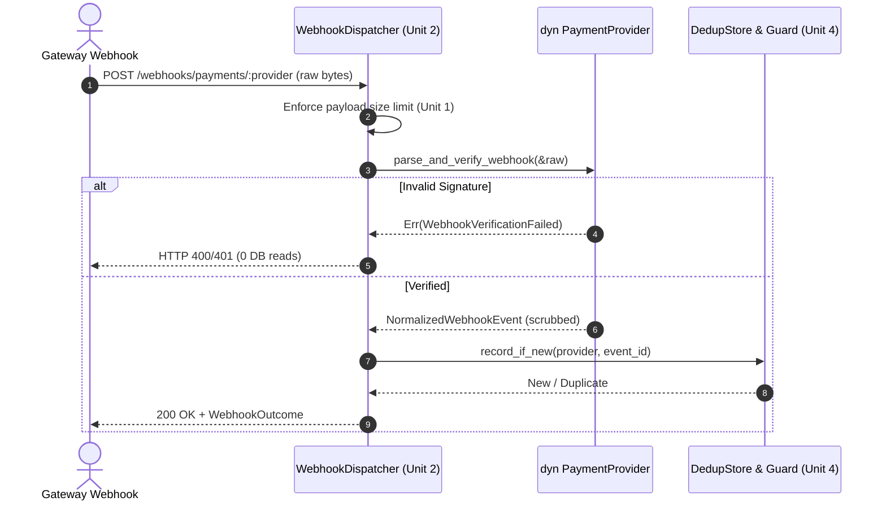

# User Story `US-3.2.0`: Unified Webhook Dispatcher, Raw-Byte Verification, Moyasar Handshake Routing & Monotonic Deduplication

- **Module**: `module-3-idempotency-webhooks` (Distributed Idempotency Boundary & Unified Webhook Pipeline)
- **Story Branch**: `feat/us-3.2.0-unified-webhook-pipeline`
- **Field Profile**: `software`
- **Story Decomposition Score ($S_{\text{story}}$)**: `2.55` $\to$ **`4` Parallel Implementation Units (`unit-1..4`)**

---

## 1. Spec Kit Specifications

### 1.1 User Story Narrative
> **As a** backend engineer exposing a single `POST /webhooks/payments/:provider` endpoint,  
> **I want** a unified webhook pipeline that verifies raw bytes before any DB read, routes Moyasar verification handshakes, deduplicates on `(provider, event_id)`, and blocks out-of-order status regressions,  
> **So that** spoofed webhooks are rejected immediately and retried/out-of-order deliveries never corrupt order state.

Implements the exact 5-step webhook ingestion pipeline from `docs/sdk-implementation.md`, ensuring verification always precedes database reads and deduplication.

#### 1.1.1 Preconditions
- `RawWebhookRequest`, `NormalizedWebhookEvent` (`module-1`), and `ProviderRegistry` (`module-2`) are merged on `main`.

#### 1.1.2 Postconditions
- Invalid signatures return `WebhookVerificationFailed` before any dedup store query.
- Populated `VerificationChallenge` routes cleanly to handshake handler.
- Monotonic transition guard rejects regressions (e.g., `Authorized` arriving after `Paid` or `Refunded`) and amount/currency mismatches.

### 1.2 Acceptance Criteria (Gherkin Scenarios)
```gherkin
Feature: Unified Multi-Gateway Webhook Pipeline

  Scenario: AC-1 — Reject tampered webhook before touching deduplication store
    Given a RawWebhookRequest with an invalid signature for provider "stripe"
    When handle_webhook("stripe", &raw) is called
    Then it returns Err(PaymentError::WebhookVerificationFailed) and performs 0 dedup store reads

  Scenario: AC-2 — Deduplicate retried webhook on (provider, event_id)
    Given a verified webhook event ("stripe", "evt_123") already recorded in WebhookDeduplicationStore
    When the same event is delivered again
    Then handle_webhook returns Ok(WebhookOutcome::Duplicate) without re-triggering fulfillment

  Scenario: AC-3 — Route Moyasar webhook_verification handshake automatically
    Given a verified NormalizedWebhookEvent with verification_challenge populated
    When handle_webhook runs
    Then it returns WebhookOutcome::VerificationHandshake(challenge) for immediate 200 OK handling

  Scenario: AC-4 — Guard against out-of-order status regression and amount mismatch
    Given an order already in PaymentStatus::Paid for 15000 SAR
    When a late Authorized event or a 1000 SAR event arrives
    Then MonotonicGuard rejects the regression / flags the amount mismatch cleanly
```

### 1.3 Test Cases & Traceability Matrix

| Test Case ID | Mapped AC | Owning Unit | Test Level | Description & Input Vector | Expected Result & Pass Threshold |
| :--- | :---: | :---: | :---: | :--- | :--- |
| `TC-3.2.1` | `AC-1` | `unit-1` | Security | Max payload byte limit (e.g., 1 MiB) & case-insensitive header lookup | Oversized body rejected before parsing |
| `TC-3.2.2` | `AC-1, AC-2` | `unit-2` | Integration | Dispatcher verifies via `PaymentProvider::parse_and_verify_webhook` before dedup | Zero dedup calls on failed signature; scrubs secret check |
| `TC-3.2.3` | `AC-3` | `unit-3` | Unit | Handshake router extracts `webhook_id` & 6-digit `verification_code` | Dispatches handshake callback without touching order ledger |
| `TC-3.2.4` | `AC-4` | `unit-4` | Unit | Monotonic transition matrix (`Authorized` after `Paid`, `Paid` after `Refunded`) & `Money` equality | Regressions rejected; mismatches flagged deterministically |

---

## 2. Technical Implementation Plan

### 2.1 Domain Invariants & Storage Schema
- **Verify-Before-DB**: Cryptographic verification MUST run before any deduplication lookup or order read.
- **Monotonic State Machine**: Terminal/later states (`Paid`, `Refunded`, `Voided`) never regress to earlier states (`Initiated`, `Authorized`, `Processing`).

### 2.2 Sequence Diagram


---

## 3. Expected Folder Architecture at the Project

```text
src/webhooks/
├── mod.rs              # Seeded on Module 3 base branch
├── raw_request.rs      # Owned exclusively by unit-1
├── dispatcher.rs       # Owned exclusively by unit-2
├── handshake.rs        # Owned exclusively by unit-3
└── dedup_guard.rs      # Owned exclusively by unit-4
```

---

## 4. Implementation Units in Detail & Specialist Agent Assignment

### 4.1 Story Decomposition Score ($S_{\text{story}}$) & Dynamic Unit Count ($K$)
- **$D_1$ (35% Surface)**: `3` — Raw request validator, provider dispatcher, verification handshake router, monotonic dedup guard
- **$D_2$ (25% Volume)**: `2` — ~550–700 production LOC
- **$D_3$ (20% Complexity)**: `3` — Verify-before-DB-read ordering, constant-time delegation, monotonic state-transition guard
- **$D_4$ (20% Boundaries)**: `2` — 4 disjoint files under `src/webhooks/`
- **Calculated Score**: $S_{\text{story}} = 0.35(3) + 0.25(2) + 0.20(3) + 0.20(2) = \mathbf{2.55}$ $\to$ **`4` Parallel Units**

### 4.2 Detailed Unit Specifications (`unit-1..4`)
- **`unit-1` (`feat/us-3.2.0/unit-1-raw-request`)**:
  - **Deliverable Scope**: Raw webhook byte-cap validation, case-insensitive header helpers & query parsing
  - **Owned Files**: `src/webhooks/raw_request.rs`
  - **Public Contract / Exports**: `ValidatedRawWebhook`, `MAX_WEBHOOK_BYTES`
  - **Unit Verification & Target Complexity**: Unit tests + doc-tests for `src/webhooks/raw_request.rs`, Max Cyclomatic Complexity $CC \le 6$ (cap $\le 10$, nesting $\le 2$)
- **`unit-2` (`feat/us-3.2.0/unit-2-dispatcher`)**:
  - **Deliverable Scope**: `WebhookDispatcher` verifying via registry before dedup & enforcing secret-scrub assertion
  - **Owned Files**: `src/webhooks/dispatcher.rs`
  - **Public Contract / Exports**: `WebhookDispatcher`, `WebhookOutcome`
  - **Unit Verification & Target Complexity**: Unit tests + doc-tests for `src/webhooks/dispatcher.rs`, Max Cyclomatic Complexity $CC \le 6$ (cap $\le 10$, nesting $\le 2$)
- **`unit-3` (`feat/us-3.2.0/unit-3-handshake`)**:
  - **Deliverable Scope**: `VerificationHandshakeHandler` trait & routing for Moyasar `webhook_verification` events
  - **Owned Files**: `src/webhooks/handshake.rs`
  - **Public Contract / Exports**: `VerificationHandshakeHandler`
  - **Unit Verification & Target Complexity**: Unit tests + doc-tests for `src/webhooks/handshake.rs`, Max Cyclomatic Complexity $CC \le 6$ (cap $\le 10$, nesting $\le 2$)
- **`unit-4` (`feat/us-3.2.0/unit-4-dedup-guard`)**:
  - **Deliverable Scope**: `WebhookDeduplicationStore` trait, `InMemoryDedupStore`, monotonic transition & `Money` match guard
  - **Owned Files**: `src/webhooks/dedup_guard.rs`
  - **Public Contract / Exports**: `WebhookDeduplicationStore`, `validate_monotonic_transition`, `verify_order_money`
  - **Unit Verification & Target Complexity**: Unit tests + doc-tests for `src/webhooks/dedup_guard.rs`, Max Cyclomatic Complexity $CC \le 6$ (cap $\le 10$, nesting $\le 2$)

### 4.3 Best-Fit Specialist Agents per Unit (`msitarzewski/agency-agents` + Core Roster)

| Unit ID | Branch Name | Primary Implementer Agent(s) (`agency-catalog`) | Reviewing Council Agent(s) | Mandatory Skills Enforced |
| :--- | :--- | :--- | :--- | :--- |
| `unit-1` | `feat/us-3.2.0/unit-1-raw-request` | `security-engineer` | `code-reviewer`, `penetration-tester`, `test-automation-engineer` | `code-review-council`, `security-audit`, `cyclomatic-complexity` |
| `unit-2` | `feat/us-3.2.0/unit-2-dispatcher` | `backend-architect` | `code-reviewer`, `application-security-engineer`, `test-automation-engineer` | `code-review-council`, `security-audit`, `cyclomatic-complexity` |
| `unit-3` | `feat/us-3.2.0/unit-3-handshake` | `api-platform-engineer` | `code-reviewer`, `security-architect`, `test-automation-engineer` | `code-review-council`, `security-audit`, `cyclomatic-complexity` |
| `unit-4` | `feat/us-3.2.0/unit-4-dedup-guard` | `backend-architect` | `code-reviewer`, `security-architect`, `test-automation-engineer` | `code-review-council`, `security-audit`, `cyclomatic-complexity` |
| **Story Remediation** | `patch/us-3.2.0-fixes` | `patch-implementer` | `code-reviewer-council-president` | Full 6-Gate Re-Verification |

### 4.4 Parallel Execution & Zero-Blocking Contract Seeding Plan
1. **Base Contract Seeding**: Seed `src/webhooks/mod.rs` on `feat/module-3-idempotency-webhooks` before branching.
2. **Simultaneous Worktree Spawning**: All 4 units are provisioned in `.worktrees/feat-us-3.2.0-unified-webhook-pipeline-unit-1..4` and spawned simultaneously in Wave 2.
3. **Ordered Cascading Merge Sequence**: `unit-1` $\to$ `unit-2` $\to$ `unit-3` $\to$ `unit-4` into `feat/us-3.2.0-unified-webhook-pipeline` via `gh pr merge <PR> --merge`.

---

## 5. Security Gateway (Powered by `security-audit` Skill)

### 5.1 Trust Boundaries & Security Actors
- **Security Actors**: Untrusted external HTTP callers claiming to be Stripe/Moyasar/Paymob; backend webhook handlers.
- **Trust Boundaries**: Public internet ingress at `POST /webhooks/payments/:provider`; cryptographic verification boundary before DB access.

### 5.2 Threat Modeling & Abuse Matrix (STRIDE / OWASP ASVS)

| Threat ID | STRIDE Category | ASVS / CWE Ref | Attack Vector / Abuse Scenario | Impact | Required Mitigation & Code Control |
| :--- | :---: | :---: | :--- | :---: | :--- |
| `TM-1` | **S**poofing | ASVS V2 / CWE-345 | Forged webhook payload without valid signature | Critical | Delegate raw bytes to provider verifier before any DB read |
| `TM-2` | **T**ampering | ASVS V5 / CWE-20 | Underpaid webhook marking full-price order as Paid | Critical | `verify_order_money` asserts exact minor-unit amount & currency match |
| `TM-3` | **R**epudiation | ASVS V7 / CWE-778 | Untracked webhook verification failure | Medium | Emit structured security alert on `WebhookVerificationFailed` |
| `TM-4` | **I**nformation Disclosure | ASVS V8 / CWE-200 | Moyasar `secret_token` leaking into logs or `raw_redacted` | Critical | Dispatcher asserts scrubbed `raw_redacted` & redacts debug output |
| `TM-5` | **D**enial of Service | ASVS V11 / CWE-400 | Multi-GB webhook body exhausting server memory | High | Enforce `MAX_WEBHOOK_BYTES` (1 MiB) before verification |
| `TM-6` | **E**levation of Privilege | ASVS V4 / CWE-285 | Replay attack re-triggering fulfillment | High | Unique `(provider, event_id)` deduplication + monotonic state guard |

### 5.3 Cryptography & Global Data Protection Controls (Worldwide Legal & Regulatory Compliance)
1. **Cryptographic Standards**: TLS 1.2/1.3+ in transit; constant-time comparison (`subtle::ConstantTimeEq`) for all HMAC digests and secret tokens; `SHA-256`/`SHA-512` only; zero hardcoded secrets or weak hashes (`MD5`/`SHA-1`).
2. **Global Multi-Jurisdictional Privacy & Legal Compliance**: Supports PCI-DSS v4.0 (zero raw PANs in logs/errors/server-side defaults), GDPR / UK GDPR, CCPA/CPRA, and regional MENA payment sovereignty (SA/EG/AE/OM/PK) via automatic `[REDACTED]` PII/secret scrubbing across UTF-8 logs and telemetry.

### 5.4 Automated Security Verification Checklist (`cloudflare/security-audit-skill`)
- [ ] Applicable `skills/security-audit/playbooks/` reviewed (`WEB-PROTOCOL-AND-AUTH.md`, `MEMORY-SAFETY-AND-BINARY.md`, `SUPPLY-CHAIN-AND-RELEASE.md`).
- [ ] All untrusted inputs validated for type, length, range, and encoding prior to domain processing.
- [ ] Zero secrets, API keys, private keys, or raw PII emitted in `Debug` formatting, logs, or error messages.
- [ ] Zero `unsafe` blocks and zero `f32`/`f64` floats for monetary calculations.

### 5.5 Security Gateway (Gate G2) Sign-Off Checklist
- [ ] **0 Critical / High / Medium** vulnerabilities in `security-audit` scan.
- [ ] All STRIDE / ASVS threat mitigations (`TM-1..TM-6`) implemented and covered by negative/security test cases in Section 1.3.
- [ ] Independent Security Reviewer agent sign-off posted to the GitHub PR conversation.

---

## 6. Validation Gates & Acceptance Sign-Off

| Gate | Gate Name | Pass Criteria for `US-3.2.0` | Verification Command / Evidence | Status |
| :--- | :--- | :--- | :--- | :---: |
| **Gate G0** | **Build, Lint & Format** | 0 errors, 0 warnings, 100% `rustfmt` compliance | `CARGO_BUILD_JOBS=1 cargo fmt --check && cargo clippy --all-targets -- -D warnings` | `[ ]` |
| **Gate G1** | **Tests, Coverage & Traceability** | 100% of `AC-*` and `TC-*` passing ($\ge 90\%$ line, $\ge 85\%$ branch coverage) | `CARGO_BUILD_JOBS=1 cargo test` | `[ ]` |
| **Gate G2** | **Security Gateway (`security-audit`)** | All Section 5 STRIDE, crypto, and global compliance checks pass (0 findings) | `security-audit` report on PR | `[ ]` |
| **Gate G-Complexity** | **Cyclomatic Complexity** | Every function $CC \le 6$ target ($CC \le 10$ ceiling, $CC > 15$ blocker, nesting $\le 2$) | `cyclomatic-complexity` table on PR | `[ ]` |
| **Gate G-Docs** | **Documentation & Doc-Tests** | 100% public symbols documented + runnable doc-tests pass | `CARGO_BUILD_JOBS=1 cargo test --doc` | `[ ]` |
| **Gate G-Review** | **Council President Sign-Off** | Independent Reviewing Council posts `GATE G-REVIEW APPROVED` on GitHub PR | `gh pr comment <PR>` | `[ ]` |

### Final Acceptance Sign-Off Block
- **Story Leader Verification**: All 4 units merged via cascading `gh pr merge`, story integration suite green, and zero unaddressed findings.
- **Reviewing Council Verdict**: `PENDING` $\to$ `GATE G-REVIEW APPROVED`
