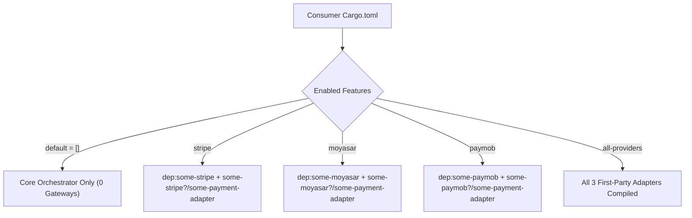

# User Story `US-4.1.0`: Feature-Gated Provider Constructors (`stripe`, `moyasar`, `paymob`, `all-providers`) & Isolated CI Matrix

- **Module**: `module-4-provider-wiring` (Optional `dep:` Feature-Gated Provider Wiring & Extension Kit)
- **Story Branch**: `feat/us-4.1.0-feature-gated-provider-constructors`
- **Field Profile**: `software`
- **Story Decomposition Score ($S_{\text{story}}$)**: `2.10` $\to$ **`4` Parallel Implementation Units (`unit-1..4`)**

---

## 1. Spec Kit Specifications

### 1.1 User Story Narrative
> **As a** Rust application developer enabling only the gateways my product uses,  
> **I want** optional `dep:` feature-gated constructors (`stripe`, `moyasar`, `paymob`, `all-providers`) with weak `?/` forwarding,  
> **So that** compiling with `--no-default-features --features stripe,paymob` never compiles or links `some-moyasar`.

Connects `some-stripe`, `some-moyasar`, and `some-paymob` adapters behind Cargo explicit `dep:` features so minimal deployments pay zero unused compile-time or binary weight.

#### 1.1.1 Preconditions
- `module-3-idempotency-webhooks` is merged on `main`.
- Module 9 (`some-payment-adapter` feature) is merged in `some-stripe`, `some-moyasar`, and `some-paymob`.

#### 1.1.2 Postconditions
- Each provider feature compiles independently with `--no-default-features --features <name>`.
- GitHub Actions CI checks all isolated feature combinations (`none`, `stripe`, `moyasar`, `paymob`, `all-providers`).

### 1.2 Acceptance Criteria (Gherkin Scenarios)
```gherkin
Feature: Feature-Gated Provider Constructors & Zero Unused Dependencies

  Scenario: AC-1 — Compile with only stripe feature enabled
    Given Cargo.toml with default = [] and explicit dep: feature flags
    When cargo check --no-default-features --features stripe runs
    Then it succeeds without compiling some-moyasar or some-paymob

  Scenario: AC-2 — Compile with all-providers enabled
    Given features = ["all-providers"]
    When stripe_provider, moyasar_provider, and paymob_provider are registered into PaymentOrchestrator
    Then all three compile and return their respective ProviderId and PaymentCapabilities

  Scenario: AC-3 — Compile core orchestrator with zero providers enabled
    Given --no-default-features
    When cargo test --no-default-features runs
    Then PaymentOrchestrator compiles and works with custom PaymentProvider implementations
```

### 1.3 Test Cases & Traceability Matrix

| Test Case ID | Mapped AC | Owning Unit | Test Level | Description & Input Vector | Expected Result & Pass Threshold |
| :--- | :---: | :---: | :---: | :--- | :--- |
| `TC-4.1.1` | `AC-1` | `unit-1` | Unit | `#[cfg(feature = "stripe")]` constructor & `StripeProvider` re-export | Compiles cleanly in isolation |
| `TC-4.1.2` | `AC-1` | `unit-2` | Unit | `#[cfg(feature = "moyasar")]` constructor & `MoyasarProvider` re-export | Compiles cleanly in isolation |
| `TC-4.1.3` | `AC-1` | `unit-3` | Unit | `#[cfg(feature = "paymob")]` constructor & `PaymobProvider` re-export | Compiles cleanly in isolation |
| `TC-4.1.4` | `AC-2, AC-3` | `unit-4` | Integration | `prelude` re-exports & isolated feature CI matrix script | All 5 feature combinations build with 0 warnings |

---

## 2. Technical Implementation Plan

### 2.1 Domain Invariants & Storage Schema
- **Explicit `dep:` Syntax**: Never leak implicit dependency-named features in `Cargo.toml`.
- **Weak Feature Forwarding**: Use `some-<gw>?/some-payment-adapter` cleanly across Cargo 1.60+.

### 2.2 Activity Diagram


---

## 3. Expected Folder Architecture at the Project

```text
src/
├── prelude.rs              # Owned exclusively by unit-4
└── providers/
    ├── mod.rs              # Seeded on Module 4 base branch
    ├── stripe.rs           # Owned exclusively by unit-1
    ├── moyasar.rs          # Owned exclusively by unit-2
    └── paymob.rs           # Owned exclusively by unit-3
```

---

## 4. Implementation Units in Detail & Specialist Agent Assignment

### 4.1 Story Decomposition Score ($S_{\text{story}}$) & Dynamic Unit Count ($K$)
- **$D_1$ (35% Surface)**: `2` — 3 feature-gated provider constructor modules + ergonomic `prelude` + CI matrix
- **$D_2$ (25% Volume)**: `2` — ~350–500 production LOC
- **$D_3$ (20% Complexity)**: `2` — Strict `#[cfg(feature = "...")]` isolation preventing feature-unification leaks
- **$D_4$ (20% Boundaries)**: `3` — 4 disjoint files under `src/providers/` and `src/prelude.rs`
- **Calculated Score**: $S_{\text{story}} = 0.35(2) + 0.25(2) + 0.20(2) + 0.20(3) = \mathbf{2.10}$ $\to$ **`4` Parallel Units**

### 4.2 Detailed Unit Specifications (`unit-1..4`)
- **`unit-1` (`feat/us-4.1.0/unit-1-stripe-wiring`)**:
  - **Deliverable Scope**: `#[cfg(feature = "stripe")]` convenience constructor `stripe_provider` & re-exports
  - **Owned Files**: `src/providers/stripe.rs`
  - **Public Contract / Exports**: `stripe_provider`
  - **Unit Verification & Target Complexity**: Unit tests + doc-tests for `src/providers/stripe.rs`, Max Cyclomatic Complexity $CC \le 6$ (cap $\le 10$, nesting $\le 2$)
- **`unit-2` (`feat/us-4.1.0/unit-2-moyasar-wiring`)**:
  - **Deliverable Scope**: `#[cfg(feature = "moyasar")]` convenience constructor `moyasar_provider` & re-exports
  - **Owned Files**: `src/providers/moyasar.rs`
  - **Public Contract / Exports**: `moyasar_provider`
  - **Unit Verification & Target Complexity**: Unit tests + doc-tests for `src/providers/moyasar.rs`, Max Cyclomatic Complexity $CC \le 6$ (cap $\le 10$, nesting $\le 2$)
- **`unit-3` (`feat/us-4.1.0/unit-3-paymob-wiring`)**:
  - **Deliverable Scope**: `#[cfg(feature = "paymob")]` convenience constructor `paymob_provider` & re-exports
  - **Owned Files**: `src/providers/paymob.rs`
  - **Public Contract / Exports**: `paymob_provider`
  - **Unit Verification & Target Complexity**: Unit tests + doc-tests for `src/providers/paymob.rs`, Max Cyclomatic Complexity $CC \le 6$ (cap $\le 10$, nesting $\le 2$)
- **`unit-4` (`feat/us-4.1.0/unit-4-prelude-ci`)**:
  - **Deliverable Scope**: Ergonomic `prelude` module + `.github/workflows/feature-matrix.yml` isolated feature checks
  - **Owned Files**: `src/prelude.rs`
  - **Public Contract / Exports**: `prelude::*`
  - **Unit Verification & Target Complexity**: Unit tests + doc-tests for `src/prelude.rs`, Max Cyclomatic Complexity $CC \le 6$ (cap $\le 10$, nesting $\le 2$)

### 4.3 Best-Fit Specialist Agents per Unit (`msitarzewski/agency-agents` + Core Roster)

| Unit ID | Branch Name | Primary Implementer Agent(s) (`agency-catalog`) | Reviewing Council Agent(s) | Mandatory Skills Enforced |
| :--- | :--- | :--- | :--- | :--- |
| `unit-1` | `feat/us-4.1.0/unit-1-stripe-wiring` | `backend-architect` | `code-reviewer`, `application-security-engineer`, `test-automation-engineer` | `code-review-council`, `security-audit`, `cyclomatic-complexity` |
| `unit-2` | `feat/us-4.1.0/unit-2-moyasar-wiring` | `backend-architect` | `code-reviewer`, `application-security-engineer`, `test-automation-engineer` | `code-review-council`, `security-audit`, `cyclomatic-complexity` |
| `unit-3` | `feat/us-4.1.0/unit-3-paymob-wiring` | `backend-architect` | `code-reviewer`, `application-security-engineer`, `test-automation-engineer` | `code-review-council`, `security-audit`, `cyclomatic-complexity` |
| `unit-4` | `feat/us-4.1.0/unit-4-prelude-ci` | `devops-automator` | `code-reviewer`, `security-architect`, `test-automation-engineer` | `code-review-council`, `security-audit`, `cyclomatic-complexity` |
| **Story Remediation** | `patch/us-4.1.0-fixes` | `patch-implementer` | `code-reviewer-council-president` | Full 6-Gate Re-Verification |

### 4.4 Parallel Execution & Zero-Blocking Contract Seeding Plan
1. **Base Contract Seeding**: Seed `Cargo.toml` optional dependencies and `src/providers/mod.rs` on `feat/module-4-provider-wiring` before branching.
2. **Simultaneous Worktree Spawning**: All 4 units are provisioned in `.worktrees/feat-us-4.1.0-feature-gated-provider-constructors-unit-1..4` and spawned simultaneously in Wave 2.
3. **Ordered Cascading Merge Sequence**: `unit-1` $\to$ `unit-2` $\to$ `unit-3` $\to$ `unit-4` into `feat/us-4.1.0-feature-gated-provider-constructors` via `gh pr merge <PR> --merge`.

---

## 5. Security Gateway (Powered by `security-audit` Skill)

### 5.1 Trust Boundaries & Security Actors
- **Security Actors**: Downstream Rust crate consumers and CI pipelines.
- **Trust Boundaries**: Feature-flag conditional compilation boundary; credential configuration handoff into provider constructors.

### 5.2 Threat Modeling & Abuse Matrix (STRIDE / OWASP ASVS)

| Threat ID | STRIDE Category | ASVS / CWE Ref | Attack Vector / Abuse Scenario | Impact | Required Mitigation & Code Control |
| :--- | :---: | :---: | :--- | :---: | :--- |
| `TM-1` | **S**poofing | ASVS V14 / CWE-1104 | Unintended crate pull via implicit Cargo feature unification | Medium | Use explicit `dep:` syntax + isolated `--no-default-features` CI checks |
| `TM-2` | **T**ampering | ASVS V14 / CWE-829 | Drifting provider crate version incompatible with `some-payment-core` | High | Pin semver-compatible `some-payment-core` across all 4 repos |
| `TM-3` | **R**epudiation | ASVS V7 / CWE-778 | Missing compile-time visibility into active providers | Low | Expose `registry.ids()` for startup diagnostics |
| `TM-4` | **I**nformation Disclosure | ASVS V8 / CWE-200 | Convenience constructor logging raw config keys | Critical | Accept redacted config structs only; zero secret logging |
| `TM-5` | **D**enial of Service | ASVS V11 / CWE-400 | Bloat from compiling unused TLS/crypto stacks | Medium | `default = []` ensures minimal default footprint |
| `TM-6` | **E**levation of Privilege | ASVS V4 / CWE-285 | Global singleton config shared across tenants | Critical | Constructors take owned per-tenant config instances exclusively |

### 5.3 Cryptography & Global Data Protection Controls (Worldwide Legal & Regulatory Compliance)
1. **Cryptographic Standards**: TLS 1.2/1.3+ in transit; constant-time comparison (`subtle::ConstantTimeEq`) for all HMAC digests and secret tokens; `SHA-256`/`SHA-512` only; zero hardcoded secrets or weak hashes (`MD5`/`SHA-1`).
2. **Global Multi-Jurisdictional Privacy & Legal Compliance**: Supports PCI-DSS v4.0 (zero raw PANs in logs/errors/server-side defaults), GDPR / UK GDPR, CCPA/CPRA, and regional MENA payment sovereignty (SA/EG/AE/OM/PK) via automatic `[REDACTED]` PII/secret scrubbing across UTF-8 logs and telemetry.

### 5.4 Automated Security Verification Checklist (`cloudflare/security-audit-skill`)
- [ ] Applicable `skills/security-audit/playbooks/` reviewed (`WEB-PROTOCOL-AND-AUTH.md`, `MEMORY-SAFETY-AND-BINARY.md`, `SUPPLY-CHAIN-AND-RELEASE.md`).
- [ ] All untrusted inputs validated for type, length, range, and encoding prior to domain processing.
- [ ] Zero secrets, API keys, private keys, or raw PII emitted in `Debug` formatting, logs, or error messages.
- [ ] Zero `unsafe` blocks and zero `f32`/`f64` floats for monetary calculations.

### 5.5 Security Gateway (Gate G2) Sign-Off Checklist
- [ ] **0 Critical / High / Medium** vulnerabilities in `security-audit` scan.
- [ ] All STRIDE / ASVS threat mitigations (`TM-1..TM-6`) implemented and covered by negative/security test cases in Section 1.3.
- [ ] Independent Security Reviewer agent sign-off posted to the GitHub PR conversation.

---

## 6. Validation Gates & Acceptance Sign-Off

| Gate | Gate Name | Pass Criteria for `US-4.1.0` | Verification Command / Evidence | Status |
| :--- | :--- | :--- | :--- | :---: |
| **Gate G0** | **Build, Lint & Format** | 0 errors, 0 warnings, 100% `rustfmt` compliance | `CARGO_BUILD_JOBS=1 cargo fmt --check && cargo clippy --all-features --all-targets -- -D warnings` | `[ ]` |
| **Gate G1** | **Tests, Coverage & Traceability** | 100% of `AC-*` and `TC-*` passing ($\ge 90\%$ line, $\ge 85\%$ branch coverage) | `CARGO_BUILD_JOBS=1 cargo test --no-default-features && cargo test --all-features` | `[ ]` |
| **Gate G2** | **Security Gateway (`security-audit`)** | All Section 5 STRIDE, crypto, and global compliance checks pass (0 findings) | `security-audit` report on PR | `[ ]` |
| **Gate G-Complexity** | **Cyclomatic Complexity** | Every function $CC \le 6$ target ($CC \le 10$ ceiling, $CC > 15$ blocker, nesting $\le 2$) | `cyclomatic-complexity` table on PR | `[ ]` |
| **Gate G-Docs** | **Documentation & Doc-Tests** | 100% public symbols documented + runnable doc-tests pass | `CARGO_BUILD_JOBS=1 cargo test --doc --all-features` | `[ ]` |
| **Gate G-Review** | **Council President Sign-Off** | Independent Reviewing Council posts `GATE G-REVIEW APPROVED` on GitHub PR | `gh pr comment <PR>` | `[ ]` |

### Final Acceptance Sign-Off Block
- **Story Leader Verification**: All 4 units merged via cascading `gh pr merge`, story integration suite green, and zero unaddressed findings.
- **Reviewing Council Verdict**: `PENDING` $\to$ `GATE G-REVIEW APPROVED`
