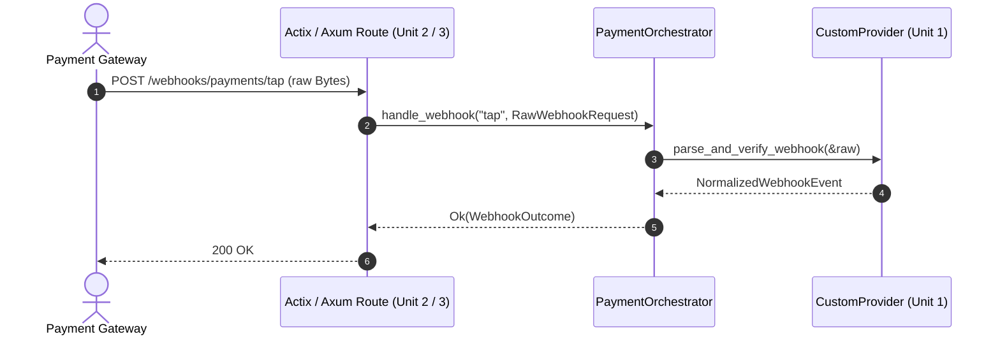

# User Story `US-4.2.0`: Open Third-Party Provider Extension Kit & Host Webhook Examples (Actix-web & Axum)

- **Module**: `module-4-provider-wiring` (Optional `dep:` Feature-Gated Provider Wiring & Extension Kit)
- **Story Branch**: `feat/us-4.2.0-third-party-extension-kit-and-examples`
- **Field Profile**: `software`
- **Story Decomposition Score ($S_{\text{story}}$)**: `1.85` $\to$ **`3` Parallel Implementation Units (`unit-1..3`)**

---

## 1. Spec Kit Specifications

### 1.1 User Story Narrative
> **As a** developer integrating a fourth provider (e.g., Tap, Tamara, Tabby) or wiring raw webhook routes in Actix-web/Axum,  
> **I want** runnable reference examples demonstrating zero-edit third-party provider registration and raw-byte webhook extraction,  
> **So that** teams can onboard new gateways and deploy secure webhook endpoints without parsing JSON before HMAC verification.

Provides canonical, compile-verified examples proving zero edits to `some-payment` or `some-payment-core` are needed to plug in future providers, plus raw-bytes webhook ingestion for Actix-web and Axum.

#### 1.1.1 Preconditions
- `US-4.1.0` feature-gated provider wiring is merged or seeded on `feat/module-4-provider-wiring`.

#### 1.1.2 Postconditions
- All 3 examples compile cleanly with `cargo check --examples --all-features`.
- Actix-web and Axum examples extract raw `Bytes` directly without pre-parsing JSON.

### 1.2 Acceptance Criteria (Gherkin Scenarios)
```gherkin
Feature: Third-Party Provider Extension & Raw-Byte Webhook Examples

  Scenario: AC-1 — Register custom fourth provider with zero edits to some-payment
    Given a custom TapMockProvider implementing only some_payment_core::PaymentProvider
    When registered alongside Stripe, Moyasar, and Paymob in PaymentOrchestrator
    Then KWD payments route to TapMockProvider with zero modifications to core crates

  Scenario: AC-2 — Actix-web and Axum webhook routes preserve exact raw bytes
    Given POST /webhooks/payments/{provider} in Actix-web and Axum examples
    When a signed raw JSON body arrives
    Then the handler passes unmodified bytes to orchestrator.handle_webhook and returns 200 OK or 401
```

### 1.3 Test Cases & Traceability Matrix

| Test Case ID | Mapped AC | Owning Unit | Test Level | Description & Input Vector | Expected Result & Pass Threshold |
| :--- | :---: | :---: | :---: | :--- | :--- |
| `TC-4.2.1` | `AC-1` | `unit-1` | Integration | Custom `TapMockProvider` registered in `PaymentOrchestrator` routing KWD | Compiles & routes KWD cleanly with fail-closed capabilities |
| `TC-4.2.2` | `AC-2` | `unit-2` | Integration | Actix-web `web::Bytes` webhook handler returns 200 on valid, 401 on tampered | Exact raw bytes preserved; zero JSON pre-parsing |
| `TC-4.2.3` | `AC-2` | `unit-3` | Integration | Axum `Bytes` webhook handler returns 200 on valid, 401 on tampered | Exact raw bytes preserved; zero JSON pre-parsing |

---

## 2. Technical Implementation Plan

### 2.1 Domain Invariants & Storage Schema
- **Raw Bytes First**: Webhook examples MUST extract `Bytes` directly before any JSON deserialization.
- **Zero Core Edits**: Custom provider example imports only `some_payment_core::PaymentProvider` to implement its adapter.

### 2.2 Sequence Diagram


---

## 3. Expected Folder Architecture at the Project

```text
examples/
├── custom_provider.rs      # Owned exclusively by unit-1
├── actix_webhooks.rs       # Owned exclusively by unit-2
└── axum_webhooks.rs        # Owned exclusively by unit-3
```

---

## 4. Implementation Units in Detail & Specialist Agent Assignment

### 4.1 Story Decomposition Score ($S_{\text{story}}$) & Dynamic Unit Count ($K$)
- **$D_1$ (35% Surface)**: `2` — Custom third-party provider example (`some-tap` mock) + Actix-web & Axum raw-bytes webhook servers
- **$D_2$ (25% Volume)**: `2` — ~350–450 LOC across runnable examples
- **$D_3$ (20% Complexity)**: `1` — Raw-bytes extractor patterns (`actix_web::web::Bytes`, `axum::body::Bytes`) before JSON middleware
- **$D_4$ (20% Boundaries)**: `2` — 3 disjoint files under `examples/`
- **Calculated Score**: $S_{\text{story}} = 0.35(2) + 0.25(2) + 0.20(1) + 0.20(2) = \mathbf{1.85}$ $\to$ **`3` Parallel Units**

### 4.2 Detailed Unit Specifications (`unit-1..3`)
- **`unit-1` (`feat/us-4.2.0/unit-1-custom-provider`)**:
  - **Deliverable Scope**: Runnable third-party `TapMockProvider` registration & KWD routing example
  - **Owned Files**: `examples/custom_provider.rs`
  - **Public Contract / Exports**: Runnable binary example `custom_provider`
  - **Unit Verification & Target Complexity**: Unit tests + doc-tests for `examples/custom_provider.rs`, Max Cyclomatic Complexity $CC \le 6$ (cap $\le 10$, nesting $\le 2$)
- **`unit-2` (`feat/us-4.2.0/unit-2-actix-webhooks`)**:
  - **Deliverable Scope**: Actix-web `POST /webhooks/payments/{provider}` using `actix_web::web::Bytes`
  - **Owned Files**: `examples/actix_webhooks.rs`
  - **Public Contract / Exports**: Runnable binary example `actix_webhooks`
  - **Unit Verification & Target Complexity**: Unit tests + doc-tests for `examples/actix_webhooks.rs`, Max Cyclomatic Complexity $CC \le 6$ (cap $\le 10$, nesting $\le 2$)
- **`unit-3` (`feat/us-4.2.0/unit-3-axum-webhooks`)**:
  - **Deliverable Scope**: Axum `POST /webhooks/payments/:provider` using `axum::body::Bytes`
  - **Owned Files**: `examples/axum_webhooks.rs`
  - **Public Contract / Exports**: Runnable binary example `axum_webhooks`
  - **Unit Verification & Target Complexity**: Unit tests + doc-tests for `examples/axum_webhooks.rs`, Max Cyclomatic Complexity $CC \le 6$ (cap $\le 10$, nesting $\le 2$)

### 4.3 Best-Fit Specialist Agents per Unit (`msitarzewski/agency-agents` + Core Roster)

| Unit ID | Branch Name | Primary Implementer Agent(s) (`agency-catalog`) | Reviewing Council Agent(s) | Mandatory Skills Enforced |
| :--- | :--- | :--- | :--- | :--- |
| `unit-1` | `feat/us-4.2.0/unit-1-custom-provider` | `api-platform-engineer` | `code-reviewer`, `application-security-engineer`, `test-automation-engineer` | `code-review-council`, `security-audit`, `cyclomatic-complexity` |
| `unit-2` | `feat/us-4.2.0/unit-2-actix-webhooks` | `backend-architect` | `code-reviewer`, `security-architect`, `test-automation-engineer` | `code-review-council`, `security-audit`, `cyclomatic-complexity` |
| `unit-3` | `feat/us-4.2.0/unit-3-axum-webhooks` | `backend-architect` | `code-reviewer`, `security-architect`, `test-automation-engineer` | `code-review-council`, `security-audit`, `cyclomatic-complexity` |
| **Story Remediation** | `patch/us-4.2.0-fixes` | `patch-implementer` | `code-reviewer-council-president` | Full 6-Gate Re-Verification |

### 4.4 Parallel Execution & Zero-Blocking Contract Seeding Plan
1. **Base Contract Seeding**: Add `[[example]]` entries in root `Cargo.toml` on `feat/module-4-provider-wiring` before branching.
2. **Simultaneous Worktree Spawning**: All 3 units are provisioned in `.worktrees/feat-us-4.2.0-third-party-extension-kit-and-examples-unit-1..3` and spawned simultaneously in Wave 2.
3. **Ordered Cascading Merge Sequence**: `unit-1` $\to$ `unit-2` $\to$ `unit-3` into `feat/us-4.2.0-third-party-extension-kit-and-examples` via `gh pr merge <PR> --merge`.

---

## 5. Security Gateway (Powered by `security-audit` Skill)

### 5.1 Trust Boundaries & Security Actors
- **Security Actors**: Developers copying reference webhook routes into production servers.
- **Trust Boundaries**: HTTP framework body extraction boundary into `RawWebhookRequest`.

### 5.2 Threat Modeling & Abuse Matrix (STRIDE / OWASP ASVS)

| Threat ID | STRIDE Category | ASVS / CWE Ref | Attack Vector / Abuse Scenario | Impact | Required Mitigation & Code Control |
| :--- | :---: | :---: | :--- | :---: | :--- |
| `TM-1` | **S**poofing | ASVS V2 / CWE-345 | Example using `web::Json` causing developers to bypass raw-byte HMAC | Critical | Strictly use `web::Bytes` / `axum::body::Bytes` |
| `TM-2` | **T**ampering | ASVS V5 / CWE-20 | Missing payload size cap in Actix/Axum extractor | High | Configure explicit 1 MiB `PayloadConfig` / `DefaultBodyLimit` |
| `TM-3` | **R**epudiation | ASVS V7 / CWE-778 | Silent 200 OK on verification failure | High | Return HTTP 400/401 on `WebhookVerificationFailed` |
| `TM-4` | **I**nformation Disclosure | ASVS V8 / CWE-200 | Hardcoded live keys in examples | Critical | Read mock/test keys from env vars with placeholder defaults |
| `TM-5` | **D**enial of Service | ASVS V11 / CWE-400 | Blocking fulfillment work before returning 200 OK | Medium | Document fast-ack async queue pattern in example handlers |
| `TM-6` | **E**levation of Privilege | ASVS V4 / CWE-285 | CSRF middleware rejecting legitimate webhooks or leaking internal errors | Medium | Exempt webhook route from CSRF; return generic 401 message |

### 5.3 Cryptography & Global Data Protection Controls (Worldwide Legal & Regulatory Compliance)
1. **Cryptographic Standards**: TLS 1.2/1.3+ in transit; constant-time comparison (`subtle::ConstantTimeEq`) for all HMAC digests and secret tokens; `SHA-256`/`SHA-512` only; zero hardcoded secrets or weak hashes (`MD5`/`SHA-1`).
2. **Global Multi-Jurisdictional Privacy & Legal Compliance**: Supports PCI-DSS v4.0 (zero raw PANs in logs/errors/server-side defaults), GDPR / UK GDPR, CCPA/CPRA, and regional MENA payment sovereignty (SA/EG/AE/OM/PK) via automatic `[REDACTED]` PII/secret scrubbing across UTF-8 logs and telemetry.

### 5.4 Automated Security Verification Checklist (`cloudflare/security-audit-skill`)
- [ ] Applicable `skills/security-audit/playbooks/` reviewed (`WEB-PROTOCOL-AND-AUTH.md`, `MEMORY-SAFETY-AND-BINARY.md`, `SUPPLY-CHAIN-AND-RELEASE.md`).
- [ ] All untrusted inputs validated for type, length, range, and encoding prior to domain processing.
- [ ] Zero secrets, API keys, private keys, or raw PII emitted in `Debug` formatting, logs, or error messages.
- [ ] Zero `unsafe` blocks and zero `f32`/`f64` floats for monetary calculations.

### 5.5 Security Gateway (Gate G2) Sign-Off Checklist
- [ ] **0 Critical / High / Medium** vulnerabilities in `security-audit` scan.
- [ ] All STRIDE / ASVS threat mitigations (`TM-1..TM-6`) implemented and covered by negative/security test cases in Section 1.3.
- [ ] Independent Security Reviewer agent sign-off posted to the GitHub PR conversation.

---

## 6. Validation Gates & Acceptance Sign-Off

| Gate | Gate Name | Pass Criteria for `US-4.2.0` | Verification Command / Evidence | Status |
| :--- | :--- | :--- | :--- | :---: |
| **Gate G0** | **Build, Lint & Format** | 0 errors, 0 warnings, 100% `rustfmt` compliance | `CARGO_BUILD_JOBS=1 cargo fmt --check && cargo clippy --examples --all-features -- -D warnings` | `[ ]` |
| **Gate G1** | **Tests, Coverage & Traceability** | 100% of `AC-*` and `TC-*` passing ($\ge 90\%$ line, $\ge 85\%$ branch coverage) | `CARGO_BUILD_JOBS=1 cargo test --examples --all-features` | `[ ]` |
| **Gate G2** | **Security Gateway (`security-audit`)** | All Section 5 STRIDE, crypto, and global compliance checks pass (0 findings) | `security-audit` report on PR | `[ ]` |
| **Gate G-Complexity** | **Cyclomatic Complexity** | Every function $CC \le 6$ target ($CC \le 10$ ceiling, $CC > 15$ blocker, nesting $\le 2$) | `cyclomatic-complexity` table on PR | `[ ]` |
| **Gate G-Docs** | **Documentation & Doc-Tests** | 100% public symbols documented + runnable doc-tests pass | `CARGO_BUILD_JOBS=1 cargo test --doc --all-features` | `[ ]` |
| **Gate G-Review** | **Council President Sign-Off** | Independent Reviewing Council posts `GATE G-REVIEW APPROVED` on GitHub PR | `gh pr comment <PR>` | `[ ]` |

### Final Acceptance Sign-Off Block
- **Story Leader Verification**: All 3 units merged via cascading `gh pr merge`, story integration suite green, and zero unaddressed findings.
- **Reviewing Council Verdict**: `PENDING` $\to$ `GATE G-REVIEW APPROVED`
