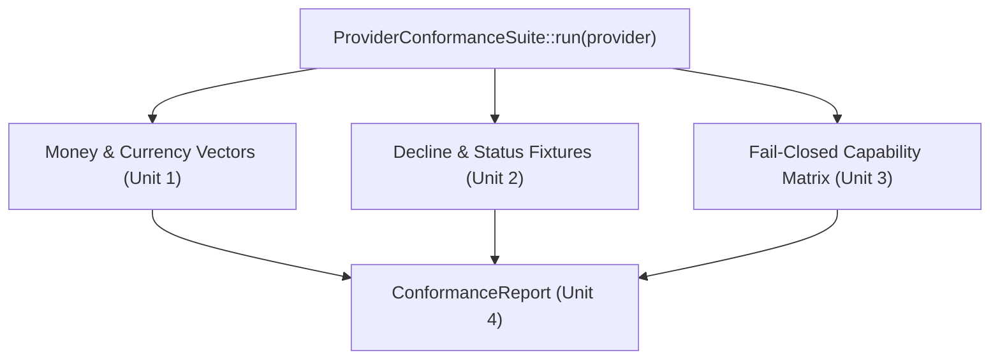

# User Story `US-5.1.0`: Money/Currency Vectors, Decline/Status Fixtures & Fail-Closed Capability Matrix Conformance Suite

- **Module**: `module-5-conformance-testing` (Reusable `ProviderConformanceSuite` (`some-payment-testing`))
- **Story Branch**: `feat/us-5.1.0-money-status-and-capability-conformance`
- **Field Profile**: `software`
- **Story Decomposition Score ($S_{\text{story}}$)**: `2.35` $\to$ **`4` Parallel Implementation Units (`unit-1..4`)**

---

## 1. Spec Kit Specifications

### 1.1 User Story Narrative
> **As a** first-party or third-party payment provider maintainer,  
> **I want** a reusable `ProviderConformanceSuite` verifying money/currency serialization, decline/ambiguous status handling, and fail-closed capabilities,  
> **So that** every provider crate proves full behavioral compliance with `some-payment-core` in CI before release.

Implements the first three conformance categories from `docs/sdk-implementation.md`: Money & Currency Vectors (0/2/3-decimal + ISK/UGX/KWD rules), Decline & Ambiguous Status Handling, and Fail-Closed Capability Matrix.

#### 1.1.1 Preconditions
- `module-4-provider-wiring` is merged on `main`.

#### 1.1.2 Postconditions
- `ProviderConformanceSuite::run(provider, mock_transport)` executes deterministically offline.
- Unclaimed capabilities are verified to fail with `Unsupported` and 0 recorded HTTP calls.

### 1.2 Acceptance Criteria (Gherkin Scenarios)
```gherkin
Feature: ProviderConformanceSuite — Money, Status & Capability Invariants

  Scenario: AC-1 — Verify 0-, 2-, and 3-decimal currency vectors
    Given a PaymentProvider wired to a mock HTTP transport
    When money_vectors suite runs across USD, SAR, EGP, JPY, and KWD
    Then exact minor-unit integers and currency casing match contract invariants

  Scenario: AC-2 — Non-paid creation responses never trigger PaymentStatus::Paid
    Given decline fixtures (Moyasar 201 failed, Stripe requires_payment_method + last_payment_error, Paymob error_occured)
    When status_fixtures suite executes
    Then none map to PaymentStatus::Paid and structured decline details are preserved

  Scenario: AC-3 — Unclaimed capabilities fail closed with 0 outbound HTTP calls
    Given a provider without AUTH_CAPTURE or SPLITS in capabilities()
    When capability_matrix suite invokes those operations
    Then each returns Err(PaymentError::Unsupported) and mock transport records 0 requests
```

### 1.3 Test Cases & Traceability Matrix

| Test Case ID | Mapped AC | Owning Unit | Test Level | Description & Input Vector | Expected Result & Pass Threshold |
| :--- | :---: | :---: | :---: | :--- | :--- |
| `TC-5.1.1` | `AC-1` | `unit-1` | Unit | Currency test vectors for `USD`, `SAR`, `EGP`, `JPY`, `KWD`, `ISK`, `UGX` | Exact minor-unit wire serialization verified |
| `TC-5.1.2` | `AC-2` | `unit-2` | Unit | Decline & ambiguous status fixture assertions | Zero false-positive `Paid` mappings |
| `TC-5.1.3` | `AC-3` | `unit-3` | Unit | Fail-closed capability matrix verifier with call counter | 0 HTTP calls on unclaimed capabilities |
| `TC-5.1.4` | `AC-1..AC-3` | `unit-4` | Integration | `ProviderConformanceSuite` runner aggregating pass/fail report | Executes cleanly against reference mock provider |

---

## 2. Technical Implementation Plan

### 2.1 Domain Invariants & Storage Schema
- **Offline Deterministic Execution**: Zero live network calls in conformance tests.
- **Zero-Call Assertion**: Mock transport records request count so fail-closed tests assert `count == 0`.

### 2.2 Activity Diagram


---

## 3. Expected Folder Architecture at the Project

```text
crates/some-payment-testing/
├── Cargo.toml                  # Seeded on Module 5 base branch
└── src/
    ├── lib.rs                  # Seeded on Module 5 base branch
    ├── money_vectors.rs        # Owned exclusively by unit-1
    ├── status_fixtures.rs      # Owned exclusively by unit-2
    ├── capability_matrix.rs    # Owned exclusively by unit-3
    └── runner.rs               # Owned exclusively by unit-4
```

---

## 4. Implementation Units in Detail & Specialist Agent Assignment

### 4.1 Story Decomposition Score ($S_{\text{story}}$) & Dynamic Unit Count ($K$)
- **$D_1$ (35% Surface)**: `3` — Money/currency vectors, decline/ambiguous status assertions, fail-closed capability matrix, suite runner
- **$D_2$ (25% Volume)**: `2` — ~500–650 LOC
- **$D_3$ (20% Complexity)**: `2` — Provider-agnostic contract test harness asserting 0 outbound calls on unclaimed capabilities
- **$D_4$ (20% Boundaries)**: `2` — 4 disjoint files under `crates/some-payment-testing/src/`
- **Calculated Score**: $S_{\text{story}} = 0.35(3) + 0.25(2) + 0.20(2) + 0.20(2) = \mathbf{2.35}$ $\to$ **`4` Parallel Units**

### 4.2 Detailed Unit Specifications (`unit-1..4`)
- **`unit-1` (`feat/us-5.1.0/unit-1-money-vectors`)**:
  - **Deliverable Scope**: 0/2/3-decimal & Stripe ISK/UGX/KWD currency conformance vectors
  - **Owned Files**: `crates/some-payment-testing/src/money_vectors.rs`
  - **Public Contract / Exports**: `run_money_vectors`
  - **Unit Verification & Target Complexity**: Unit tests + doc-tests for `crates/some-payment-testing/src/money_vectors.rs`, Max Cyclomatic Complexity $CC \le 6$ (cap $\le 10$, nesting $\le 2$)
- **`unit-2` (`feat/us-5.1.0/unit-2-status-fixtures`)**:
  - **Deliverable Scope**: Decline, ambiguous HTTP 201, and partial capture/refund status assertions
  - **Owned Files**: `crates/some-payment-testing/src/status_fixtures.rs`
  - **Public Contract / Exports**: `run_status_fixtures`
  - **Unit Verification & Target Complexity**: Unit tests + doc-tests for `crates/some-payment-testing/src/status_fixtures.rs`, Max Cyclomatic Complexity $CC \le 6$ (cap $\le 10$, nesting $\le 2$)
- **`unit-3` (`feat/us-5.1.0/unit-3-capability-matrix`)**:
  - **Deliverable Scope**: Fail-closed capability matrix test harness asserting 0 outbound calls
  - **Owned Files**: `crates/some-payment-testing/src/capability_matrix.rs`
  - **Public Contract / Exports**: `run_capability_matrix`
  - **Unit Verification & Target Complexity**: Unit tests + doc-tests for `crates/some-payment-testing/src/capability_matrix.rs`, Max Cyclomatic Complexity $CC \le 6$ (cap $\le 10$, nesting $\le 2$)
- **`unit-4` (`feat/us-5.1.0/unit-4-runner`)**:
  - **Deliverable Scope**: `ProviderConformanceSuite` orchestrator & structured `ConformanceReport`
  - **Owned Files**: `crates/some-payment-testing/src/runner.rs`
  - **Public Contract / Exports**: `ProviderConformanceSuite`, `ConformanceReport`
  - **Unit Verification & Target Complexity**: Unit tests + doc-tests for `crates/some-payment-testing/src/runner.rs`, Max Cyclomatic Complexity $CC \le 6$ (cap $\le 10$, nesting $\le 2$)

### 4.3 Best-Fit Specialist Agents per Unit (`msitarzewski/agency-agents` + Core Roster)

| Unit ID | Branch Name | Primary Implementer Agent(s) (`agency-catalog`) | Reviewing Council Agent(s) | Mandatory Skills Enforced |
| :--- | :--- | :--- | :--- | :--- |
| `unit-1` | `feat/us-5.1.0/unit-1-money-vectors` | `test-automation-engineer` | `code-reviewer`, `application-security-engineer`, `test-automation-engineer` | `code-review-council`, `security-audit`, `cyclomatic-complexity` |
| `unit-2` | `feat/us-5.1.0/unit-2-status-fixtures` | `test-automation-engineer` | `code-reviewer`, `security-architect`, `test-automation-engineer` | `code-review-council`, `security-audit`, `cyclomatic-complexity` |
| `unit-3` | `feat/us-5.1.0/unit-3-capability-matrix` | `test-automation-engineer` | `code-reviewer`, `application-security-engineer`, `test-automation-engineer` | `code-review-council`, `security-audit`, `cyclomatic-complexity` |
| `unit-4` | `feat/us-5.1.0/unit-4-runner` | `backend-architect` | `code-reviewer`, `security-architect`, `test-automation-engineer` | `code-review-council`, `security-audit`, `cyclomatic-complexity` |
| **Story Remediation** | `patch/us-5.1.0-fixes` | `patch-implementer` | `code-reviewer-council-president` | Full 6-Gate Re-Verification |

### 4.4 Parallel Execution & Zero-Blocking Contract Seeding Plan
1. **Base Contract Seeding**: Seed `crates/some-payment-testing/Cargo.toml` and `src/lib.rs` on `feat/module-5-conformance-testing` before branching.
2. **Simultaneous Worktree Spawning**: All 4 units are provisioned in `.worktrees/feat-us-5.1.0-money-status-and-capability-conformance-unit-1..4` and spawned simultaneously in Wave 2.
3. **Ordered Cascading Merge Sequence**: `unit-1` $\to$ `unit-2` $\to$ `unit-3` $\to$ `unit-4` into `feat/us-5.1.0-money-status-and-capability-conformance` via `gh pr merge <PR> --merge`.

---

## 5. Security Gateway (Powered by `security-audit` Skill)

### 5.1 Trust Boundaries & Security Actors
- **Security Actors**: CI pipelines and third-party provider SDK authors.
- **Trust Boundaries**: Conformance test fixtures and mock HTTP request/response recording.

### 5.2 Threat Modeling & Abuse Matrix (STRIDE / OWASP ASVS)

| Threat ID | STRIDE Category | ASVS / CWE Ref | Attack Vector / Abuse Scenario | Impact | Required Mitigation & Code Control |
| :--- | :---: | :---: | :--- | :---: | :--- |
| `TM-1` | **S**poofing | ASVS V14 / CWE-345 | Provider silently ignoring capability checks and making live calls | High | Assert mock transport call count == 0 for unclaimed capabilities |
| `TM-2` | **T**ampering | ASVS V5 / CWE-190 | Hidden `amount * 100` double-scaling bug in adapter | Critical | Exact wire-payload minor-unit assertions across 0/2/3-decimal currencies |
| `TM-3` | **R**epudiation | ASVS V7 / CWE-778 | Skipped conformance checks hidden in CI | Medium | Emit itemized `ConformanceReport` listing every executed gate |
| `TM-4` | **I**nformation Disclosure | ASVS V8 / CWE-200 | Live merchant keys accidentally committed in test fixtures | Critical | Use strictly synthetic dummy keys (`sk_test_mock_...`) in fixtures |
| `TM-5` | **D**enial of Service | ASVS V11 / CWE-400 | Flaky network calls in unit tests | Medium | 100% offline mock transport with zero external DNS/network calls |
| `TM-6` | **E**levation of Privilege | ASVS V4 / CWE-285 | Failed payment mapped to `Paid` granting unpaid goods | Critical | Mandatory negative status fixture assertions |

### 5.3 Cryptography & Global Data Protection Controls (Worldwide Legal & Regulatory Compliance)
1. **Cryptographic Standards**: TLS 1.2/1.3+ in transit; constant-time comparison (`subtle::ConstantTimeEq`) for all HMAC digests and secret tokens; `SHA-256`/`SHA-512` only; zero hardcoded secrets or weak hashes (`MD5`/`SHA-1`).
2. **Global Multi-Jurisdictional Privacy & Legal Compliance**: Supports PCI-DSS v4.0 (zero raw PANs in logs/errors/server-side defaults), GDPR / UK GDPR, CCPA/CPRA, and regional MENA payment sovereignty (SA/EG/AE/OM/PK) via automatic `[REDACTED]` PII/secret scrubbing across UTF-8 logs and telemetry.

### 5.4 Automated Security Verification Checklist (`cloudflare/security-audit-skill`)
- [ ] Applicable `skills/security-audit/playbooks/` reviewed (`WEB-PROTOCOL-AND-AUTH.md`, `MEMORY-SAFETY-AND-BINARY.md`, `SUPPLY-CHAIN-AND-RELEASE.md`).
- [ ] All untrusted inputs validated for type, length, range, and encoding prior to domain processing.
- [ ] Zero secrets, API keys, private keys, or raw PII emitted in `Debug` formatting, logs, or error messages.
- [ ] Zero `unsafe` blocks and zero `f32`/`f64` floats for monetary calculations.

### 5.5 Security Gateway (Gate G2) Sign-Off Checklist
- [ ] **0 Critical / High / Medium** vulnerabilities in `security-audit` scan.
- [ ] All STRIDE / ASVS threat mitigations (`TM-1..TM-6`) implemented and covered by negative/security test cases in Section 1.3.
- [ ] Independent Security Reviewer agent sign-off posted to the GitHub PR conversation.

---

## 6. Validation Gates & Acceptance Sign-Off

| Gate | Gate Name | Pass Criteria for `US-5.1.0` | Verification Command / Evidence | Status |
| :--- | :--- | :--- | :--- | :---: |
| **Gate G0** | **Build, Lint & Format** | 0 errors, 0 warnings, 100% `rustfmt` compliance | `CARGO_BUILD_JOBS=1 cargo fmt --check && cargo clippy -p some-payment-testing --all-targets -- -D warnings` | `[ ]` |
| **Gate G1** | **Tests, Coverage & Traceability** | 100% of `AC-*` and `TC-*` passing ($\ge 90\%$ line, $\ge 85\%$ branch coverage) | `CARGO_BUILD_JOBS=1 cargo test -p some-payment-testing` | `[ ]` |
| **Gate G2** | **Security Gateway (`security-audit`)** | All Section 5 STRIDE, crypto, and global compliance checks pass (0 findings) | `security-audit` report on PR | `[ ]` |
| **Gate G-Complexity** | **Cyclomatic Complexity** | Every function $CC \le 6$ target ($CC \le 10$ ceiling, $CC > 15$ blocker, nesting $\le 2$) | `cyclomatic-complexity` table on PR | `[ ]` |
| **Gate G-Docs** | **Documentation & Doc-Tests** | 100% public symbols documented + runnable doc-tests pass | `CARGO_BUILD_JOBS=1 cargo test --doc -p some-payment-testing` | `[ ]` |
| **Gate G-Review** | **Council President Sign-Off** | Independent Reviewing Council posts `GATE G-REVIEW APPROVED` on GitHub PR | `gh pr comment <PR>` | `[ ]` |

### Final Acceptance Sign-Off Block
- **Story Leader Verification**: All 4 units merged via cascading `gh pr merge`, story integration suite green, and zero unaddressed findings.
- **Reviewing Council Verdict**: `PENDING` $\to$ `GATE G-REVIEW APPROVED`
