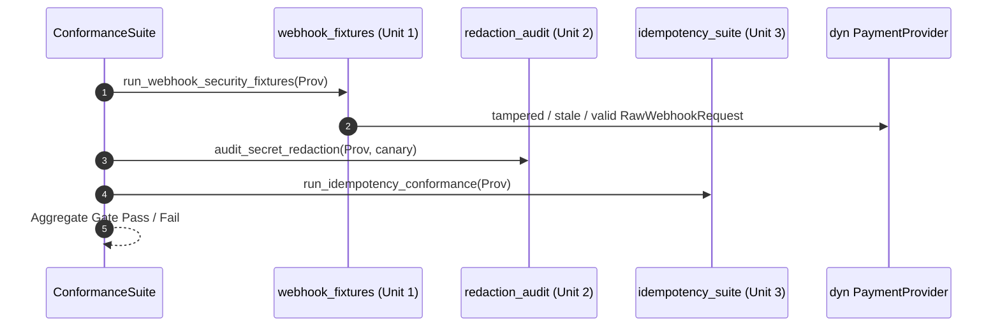

# User Story `US-5.2.0`: Webhook Security Fixtures, Secret-Redaction Auditors & Idempotency Lock-Retention Conformance Suite

- **Module**: `module-5-conformance-testing` (Reusable `ProviderConformanceSuite` (`some-payment-testing`))
- **Story Branch**: `feat/us-5.2.0-webhook-redaction-and-idempotency-conformance`
- **Field Profile**: `software`
- **Story Decomposition Score ($S_{\text{story}}$)**: `2.45` $\to$ **`4` Parallel Implementation Units (`unit-1..4`)**

---

## 1. Spec Kit Specifications

### 1.1 User Story Narrative
> **As a** security & payments engineer certifying a provider for production,  
> **I want** automated conformance tests for webhook cryptographic security, zero secret leakage in `Debug`/logs, and idempotency lock retention,  
> **So that** every provider passes all 10 New Provider Readiness Acceptance Gates in CI.

Completes `ProviderConformanceSuite` with webhook tampering/replay/rotation fixtures, automated `Debug`/`Display` secret-leak assertions, and distributed idempotency lock-retention verification.

#### 1.1.1 Preconditions
- `US-5.1.0` crate scaffolding is present on `feat/module-5-conformance-testing`.

#### 1.1.2 Postconditions
- Tampered webhook bodies, stale timestamps (`t > 300s`), `v0`-only downgrade attacks, and forged HMACs are verified rejected.
- Secret-redaction auditor confirms canary secrets never appear in `Debug` or `raw_redacted`.
- Idempotency suite verifies cached replay and indeterminate-timeout lock retention.

### 1.2 Acceptance Criteria (Gherkin Scenarios)
```gherkin
Feature: ProviderConformanceSuite — Webhook Security, Redaction & Idempotency

  Scenario: AC-1 — Reject tampered, stale, and downgraded webhook fixtures
    Given webhook fixtures with tampered bytes, stale timestamps (> 300s), and forged digests
    When webhook_fixtures suite runs against a PaymentProvider
    Then every adversarial fixture returns Err(PaymentError::WebhookVerificationFailed)

  Scenario: AC-2 — Secret-redaction auditor detects zero leaked canaries
    Given a provider configured with canary secret "CANARY_SECRET_KEY_999"
    When redaction_audit formats provider Debug, PaymentError Debug, and NormalizedWebhookEvent raw_redacted
    Then "CANARY_SECRET_KEY_999" appears 0 times

  Scenario: AC-3 — Idempotency suite verifies cached replay and timeout lock retention
    Given a non-idempotent refund mutation followed by a simulated timeout
    When idempotency_suite executes
    Then duplicate keys replay cached results and timeout errors keep the lock acquired
```

### 1.3 Test Cases & Traceability Matrix

| Test Case ID | Mapped AC | Owning Unit | Test Level | Description & Input Vector | Expected Result & Pass Threshold |
| :--- | :---: | :---: | :---: | :--- | :--- |
| `TC-5.2.1` | `AC-1` | `unit-1` | Security | Adversarial webhook fixtures (Stripe re-serialized/v0/stale/dual-v1, Moyasar secret_token/payment_faild, Paymob 20-key/8-key/subscription) | All tampered/forged rejected; valid fixtures normalized |
| `TC-5.2.2` | `AC-2` | `unit-2` | Security | Canary secret string scan across `Debug`, `Display`, and `raw_redacted` | 0 occurrences of canary secret |
| `TC-5.2.3` | `AC-3` | `unit-3` | Concurrency | Idempotency lock replay, concurrent conflict, and 504 timeout lock retention | 0 duplicate provider mutations; lock retained on timeout |
| `TC-5.2.4` | `AC-1..AC-3` | `unit-4` | Unit | Reusable `MockPaymentProvider` & offline `wiremock` helper harness | Deterministic offline execution with request call counter |

---

## 2. Technical Implementation Plan

### 2.1 Domain Invariants & Storage Schema
- **Canary Secret Zero-Leakage**: Every provider config, error, and redacted webhook must pass canary scan.
- **Full 10-Gate Readiness**: Covers all 10 items from the New Provider Readiness Acceptance Checklist.

### 2.2 Sequence Diagram


---

## 3. Expected Folder Architecture at the Project

```text
crates/some-payment-testing/src/
├── webhook_fixtures.rs     # Owned exclusively by unit-1
├── redaction_audit.rs      # Owned exclusively by unit-2
├── idempotency_suite.rs    # Owned exclusively by unit-3
└── mock_transport.rs       # Owned exclusively by unit-4
```

---

## 4. Implementation Units in Detail & Specialist Agent Assignment

### 4.1 Story Decomposition Score ($S_{\text{story}}$) & Dynamic Unit Count ($K$)
- **$D_1$ (35% Surface)**: `3` — Webhook security fixtures, automated secret-redaction auditor, idempotency lock-retention suite, mock transport
- **$D_2$ (25% Volume)**: `2` — ~500–650 LOC
- **$D_3$ (20% Complexity)**: `3` — Tampered payload, stale timestamp, downgrade attack, secret scrubbing, and timeout lock retention verification
- **$D_4$ (20% Boundaries)**: `2` — 4 disjoint files under `crates/some-payment-testing/src/`
- **Calculated Score**: $S_{\text{story}} = 0.35(3) + 0.25(2) + 0.20(3) + 0.20(2) = \mathbf{2.45}$ $\to$ **`4` Parallel Units**

### 4.2 Detailed Unit Specifications (`unit-1..4`)
- **`unit-1` (`feat/us-5.2.0/unit-1-webhook-fixtures`)**:
  - **Deliverable Scope**: Adversarial & valid webhook security fixtures for Stripe, Moyasar, and Paymob
  - **Owned Files**: `crates/some-payment-testing/src/webhook_fixtures.rs`
  - **Public Contract / Exports**: `run_webhook_fixtures`
  - **Unit Verification & Target Complexity**: Unit tests + doc-tests for `crates/some-payment-testing/src/webhook_fixtures.rs`, Max Cyclomatic Complexity $CC \le 6$ (cap $\le 10$, nesting $\le 2$)
- **`unit-2` (`feat/us-5.2.0/unit-2-redaction-audit`)**:
  - **Deliverable Scope**: Automated canary secret scanner over `Debug`, `Display`, and `raw_redacted`
  - **Owned Files**: `crates/some-payment-testing/src/redaction_audit.rs`
  - **Public Contract / Exports**: `audit_secret_redaction`
  - **Unit Verification & Target Complexity**: Unit tests + doc-tests for `crates/some-payment-testing/src/redaction_audit.rs`, Max Cyclomatic Complexity $CC \le 6$ (cap $\le 10$, nesting $\le 2$)
- **`unit-3` (`feat/us-5.2.0/unit-3-idempotency-suite`)**:
  - **Deliverable Scope**: Idempotency replay, concurrent lock conflict, and timeout lock-retention conformance tests
  - **Owned Files**: `crates/some-payment-testing/src/idempotency_suite.rs`
  - **Public Contract / Exports**: `run_idempotency_suite`
  - **Unit Verification & Target Complexity**: Unit tests + doc-tests for `crates/some-payment-testing/src/idempotency_suite.rs`, Max Cyclomatic Complexity $CC \le 6$ (cap $\le 10$, nesting $\le 2$)
- **`unit-4` (`feat/us-5.2.0/unit-4-mock-transport`)**:
  - **Deliverable Scope**: Reusable `MockPaymentProvider` & offline `wiremock` request-counting harness
  - **Owned Files**: `crates/some-payment-testing/src/mock_transport.rs`
  - **Public Contract / Exports**: `MockPaymentProvider`, `CountingMockServer`
  - **Unit Verification & Target Complexity**: Unit tests + doc-tests for `crates/some-payment-testing/src/mock_transport.rs`, Max Cyclomatic Complexity $CC \le 6$ (cap $\le 10$, nesting $\le 2$)

### 4.3 Best-Fit Specialist Agents per Unit (`msitarzewski/agency-agents` + Core Roster)

| Unit ID | Branch Name | Primary Implementer Agent(s) (`agency-catalog`) | Reviewing Council Agent(s) | Mandatory Skills Enforced |
| :--- | :--- | :--- | :--- | :--- |
| `unit-1` | `feat/us-5.2.0/unit-1-webhook-fixtures` | `security-engineer` | `code-reviewer`, `penetration-tester`, `test-automation-engineer` | `code-review-council`, `security-audit`, `cyclomatic-complexity` |
| `unit-2` | `feat/us-5.2.0/unit-2-redaction-audit` | `security-engineer` | `code-reviewer`, `application-security-engineer`, `test-automation-engineer` | `code-review-council`, `security-audit`, `cyclomatic-complexity` |
| `unit-3` | `feat/us-5.2.0/unit-3-idempotency-suite` | `test-automation-engineer` | `code-reviewer`, `security-architect`, `test-automation-engineer` | `code-review-council`, `security-audit`, `cyclomatic-complexity` |
| `unit-4` | `feat/us-5.2.0/unit-4-mock-transport` | `test-automation-engineer` | `code-reviewer`, `application-security-engineer`, `test-automation-engineer` | `code-review-council`, `security-audit`, `cyclomatic-complexity` |
| **Story Remediation** | `patch/us-5.2.0-fixes` | `patch-implementer` | `code-reviewer-council-president` | Full 6-Gate Re-Verification |

### 4.4 Parallel Execution & Zero-Blocking Contract Seeding Plan
1. **Base Contract Seeding**: Seed module exports in `crates/some-payment-testing/src/lib.rs` on `feat/module-5-conformance-testing` before branching.
2. **Simultaneous Worktree Spawning**: All 4 units are provisioned in `.worktrees/feat-us-5.2.0-webhook-redaction-and-idempotency-conformance-unit-1..4` and spawned simultaneously in Wave 2.
3. **Ordered Cascading Merge Sequence**: `unit-1` $\to$ `unit-2` $\to$ `unit-3` $\to$ `unit-4` into `feat/us-5.2.0-webhook-redaction-and-idempotency-conformance` via `gh pr merge <PR> --merge`.

---

## 5. Security Gateway (Powered by `security-audit` Skill)

### 5.1 Trust Boundaries & Security Actors
- **Security Actors**: Security reviewers, CI runners, provider SDK maintainers.
- **Trust Boundaries**: Webhook cryptographic verification boundary and telemetry/logging output boundary.

### 5.2 Threat Modeling & Abuse Matrix (STRIDE / OWASP ASVS)

| Threat ID | STRIDE Category | ASVS / CWE Ref | Attack Vector / Abuse Scenario | Impact | Required Mitigation & Code Control |
| :--- | :---: | :---: | :--- | :---: | :--- |
| `TM-1` | **S**poofing | ASVS V2 / CWE-345 | Stripe `v0` test signature accepted in production | Critical | Dedicated `v0`-only downgrade attack fixture |
| `TM-2` | **T**ampering | ASVS V5 / CWE-345 | Re-serialized JSON altering whitespace before HMAC check | High | Re-serialized JSON rejection fixture |
| `TM-3` | **R**epudiation | ASVS V7 / CWE-778 | Missing audit evidence of readiness checklist pass | Medium | Generate deterministic 10-gate readiness summary |
| `TM-4` | **I**nformation Disclosure | ASVS V8 / CWE-200 | Secret key leaked via derived `Debug` | Critical | Automated canary scan fails CI immediately on any match |
| `TM-5` | **D**enial of Service | ASVS V11 / CWE-400 | Replay storm bypassing 300s tolerance | High | Stale timestamp (`t > 300s`) rejection fixture |
| `TM-6` | **E**levation of Privilege | ASVS V4 / CWE-285 | Duplicate refund after network timeout | Critical | Timeout lock-retention conformance test |

### 5.3 Cryptography & Global Data Protection Controls (Worldwide Legal & Regulatory Compliance)
1. **Cryptographic Standards**: TLS 1.2/1.3+ in transit; constant-time comparison (`subtle::ConstantTimeEq`) for all HMAC digests and secret tokens; `SHA-256`/`SHA-512` only; zero hardcoded secrets or weak hashes (`MD5`/`SHA-1`).
2. **Global Multi-Jurisdictional Privacy & Legal Compliance**: Supports PCI-DSS v4.0 (zero raw PANs in logs/errors/server-side defaults), GDPR / UK GDPR, CCPA/CPRA, and regional MENA payment sovereignty (SA/EG/AE/OM/PK) via automatic `[REDACTED]` PII/secret scrubbing across UTF-8 logs and telemetry.

### 5.4 Automated Security Verification Checklist (`cloudflare/security-audit-skill`)
- [ ] Applicable `skills/security-audit/playbooks/` reviewed (`WEB-PROTOCOL-AND-AUTH.md`, `MEMORY-SAFETY-AND-BINARY.md`, `SUPPLY-CHAIN-AND-RELEASE.md`).
- [ ] All untrusted inputs validated for type, length, range, and encoding prior to domain processing.
- [ ] Zero secrets, API keys, private keys, or raw PII emitted in `Debug` formatting, logs, or error messages.
- [ ] Zero `unsafe` blocks and zero `f32`/`f64` floats for monetary calculations.

### 5.5 Security Gateway (Gate G2) Sign-Off Checklist
- [ ] **0 Critical / High / Medium** vulnerabilities in `security-audit` scan.
- [ ] All STRIDE / ASVS threat mitigations (`TM-1..TM-6`) implemented and covered by negative/security test cases in Section 1.3.
- [ ] Independent Security Reviewer agent sign-off posted to the GitHub PR conversation.

---

## 6. Validation Gates & Acceptance Sign-Off

| Gate | Gate Name | Pass Criteria for `US-5.2.0` | Verification Command / Evidence | Status |
| :--- | :--- | :--- | :--- | :---: |
| **Gate G0** | **Build, Lint & Format** | 0 errors, 0 warnings, 100% `rustfmt` compliance | `CARGO_BUILD_JOBS=1 cargo fmt --check && cargo clippy -p some-payment-testing --all-targets -- -D warnings` | `[ ]` |
| **Gate G1** | **Tests, Coverage & Traceability** | 100% of `AC-*` and `TC-*` passing ($\ge 90\%$ line, $\ge 85\%$ branch coverage) | `CARGO_BUILD_JOBS=1 cargo test -p some-payment-testing` | `[ ]` |
| **Gate G2** | **Security Gateway (`security-audit`)** | All Section 5 STRIDE, crypto, and global compliance checks pass (0 findings) | `security-audit` report on PR | `[ ]` |
| **Gate G-Complexity** | **Cyclomatic Complexity** | Every function $CC \le 6$ target ($CC \le 10$ ceiling, $CC > 15$ blocker, nesting $\le 2$) | `cyclomatic-complexity` table on PR | `[ ]` |
| **Gate G-Docs** | **Documentation & Doc-Tests** | 100% public symbols documented + runnable doc-tests pass | `CARGO_BUILD_JOBS=1 cargo test --doc -p some-payment-testing` | `[ ]` |
| **Gate G-Review** | **Council President Sign-Off** | Independent Reviewing Council posts `GATE G-REVIEW APPROVED` on GitHub PR | `gh pr comment <PR>` | `[ ]` |

### Final Acceptance Sign-Off Block
- **Story Leader Verification**: All 4 units merged via cascading `gh pr merge`, story integration suite green, and zero unaddressed findings.
- **Reviewing Council Verdict**: `PENDING` $\to$ `GATE G-REVIEW APPROVED`
